# Lab 10: Discover and Govern Shadow IT with Microsoft Defender for Cloud Apps

## Objectives

Employees use hundreds of cloud apps that IT never approved. Microsoft Defender for Cloud Apps uses traffic seen by Defender on your devices to discover these apps, rate their risk, and block the ones you don't trust. In this lab you will onboard a device and connect it to Defender for Cloud Apps, discover cloud apps, sanction and block apps, turn on app governance for OAuth apps, connect Microsoft 365, and configure threat detection policies.

- Onboard a Windows device and turn on the Defender for Endpoint integration with Defender for Cloud Apps

- Discover and assess cloud apps used on the device

- Sanction, monitor and block apps with Defender for Endpoint enforcement

- Turn on app governance and review OAuth apps

- Connect Microsoft 365 with an app connector

- Review and create threat detection policies

**Prerequisites**

A lab administrator account with the **Global Administrator** role.

A **Windows 11** lab VM on which you can sign in as a local administrator.

Microsoft Defender for Cloud Apps (included in the Defender Suite for Business Premium or Microsoft 365 E5) and Defender for Business or Defender for Endpoint.

**This lab is self-contained. It does not depend on any other lab in the course; Exercise 1 creates everything the lab needs. If an object already exists in your tenant (for example because another lab created it earlier today), skip that step.**

**Several features in this lab take time to show data: discovered apps up to 2 hours, app blocking up to 3 hours, and app governance up to 10 hours. Complete Exercise 1 at the start of the day so that later exercises have data.**

## Exercise 1: Prepare the Lab Environment

In this exercise you make sure the VM is onboarded to Defender with network protection in block mode, turn on the integrations this lab needs, and start the features that take time to populate.

### Task 1: Onboard the device (if not already onboarded)

1.  Open the Microsoft Defender portal at https://security.microsoft.com and go to **Assets \> Devices**. If the Windows 11 VM is listed as **Onboarded**, skip to Task 2.

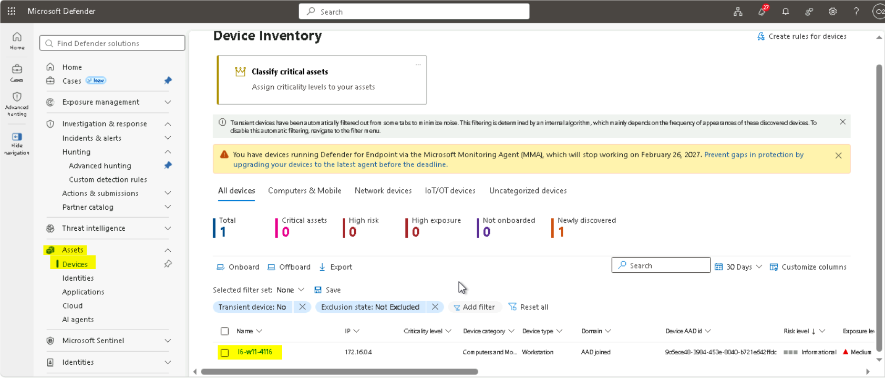
>
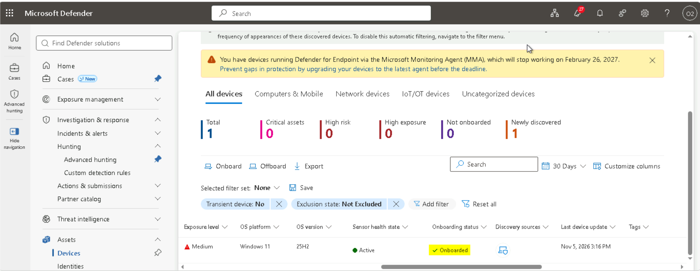

2.  Go to **Settings \> Endpoints \> Device management \> Onboarding**. Select **Windows 10 and 11**, **Connectivity type** **Streamlined**, **Deployment method** **Local script**, and click **Download onboarding package**.

3.  On the VM, extract the package to the **Desktop**, open **Command Prompt** as administrator, run the script, and type **Y** when prompted:

```powershell
%userprofile%\Desktop\WindowsDefenderATPLocalOnboardingScript.cmd
```

**Note** - The device appears in **Assets \> Devices** within about 10-30 minutes.

### Task 2: Turn on network protection on the VM

Blocking unsanctioned apps relies on Defender Antivirus network protection in block mode.

1.  On the VM, open **Windows PowerShell** as administrator and run:

```powershell
Set-MpPreference -EnableNetworkProtection Enabled
Get-MpPreference | Select-Object EnableNetworkProtection
```

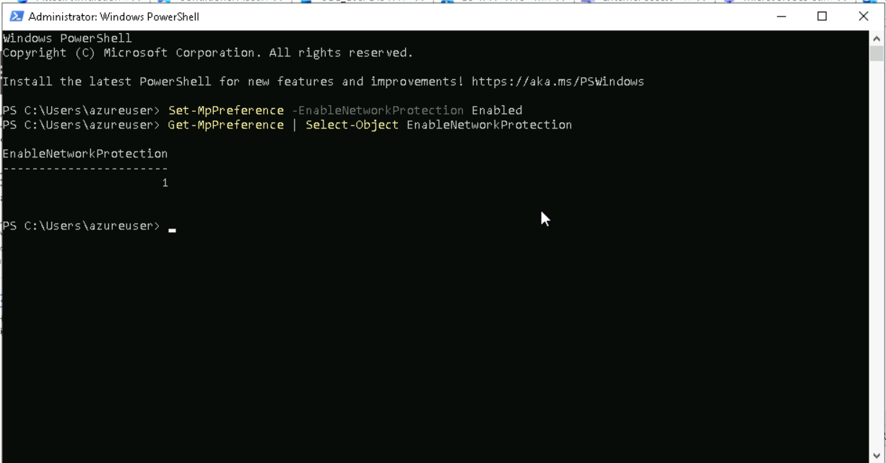 **Note** - A value of **1** means block mode. In production, configure this with an Intune antivirus policy or the Defender for Business next-generation protection policy instead.

### Task 3: Turn on the Defender integrations

1.  In the Defender portal, go to **Settings \> Endpoints \> General \> Optional features**.

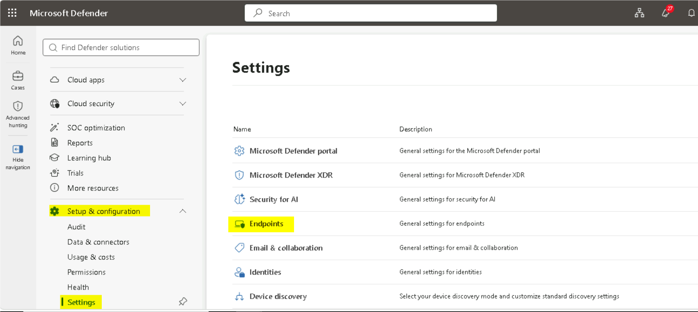

2.  Turn **On** **Microsoft Defender for Cloud Apps** and **Custom network indicators**, then click **Save preferences**.

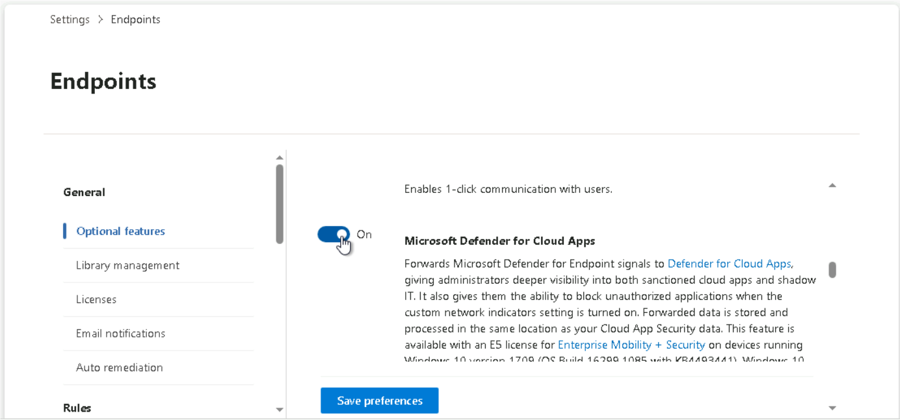
>
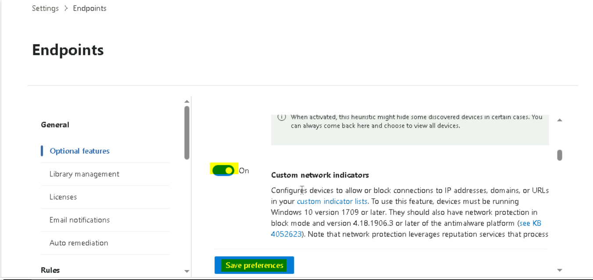

3.  Go to **Settings \> Cloud Apps \> Cloud Discovery \> Microsoft Defender for Endpoint** and select **Enforce app access**. Click **Save**.

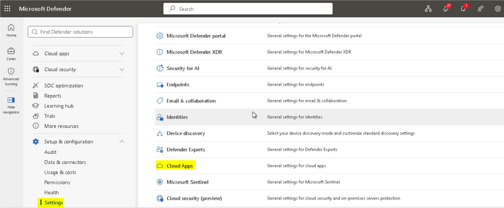

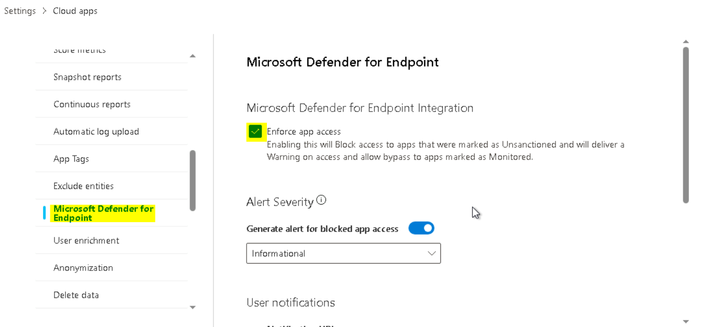

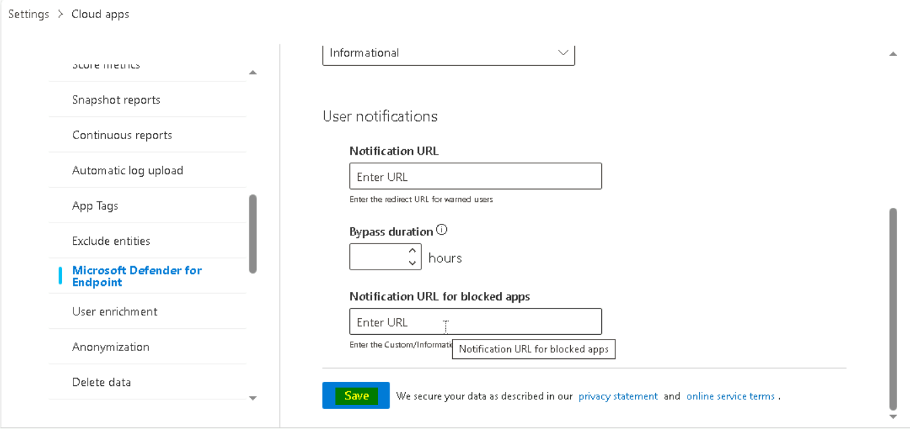

4.  Click **Yes** on the App control consent.

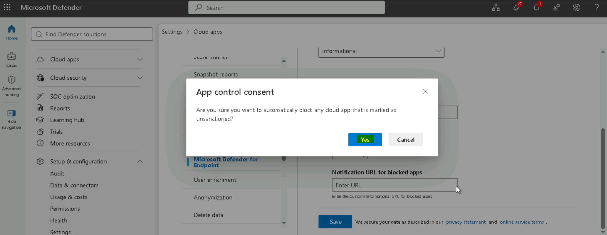

**Note** - Enforce app access can take up to 30 minutes to take effect.

### Task 4: Start the features that need time to populate

1.  In the Defender portal, go to **System \> Settings \> Cloud apps**. In the settings list, scroll down to **App governance** and select **Service status**.

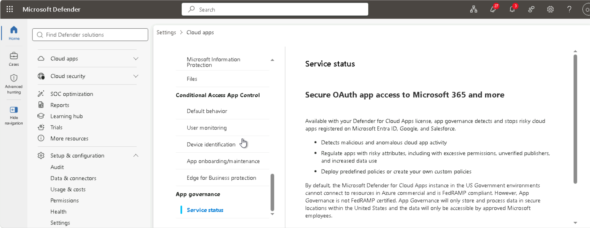

2.  Scroll down the **Service status** pane, past the **Secure OAuth app access to Microsoft 365 and more** description and turn on app governance with the **Turn on app governance** option. Click **Save** if prompted.

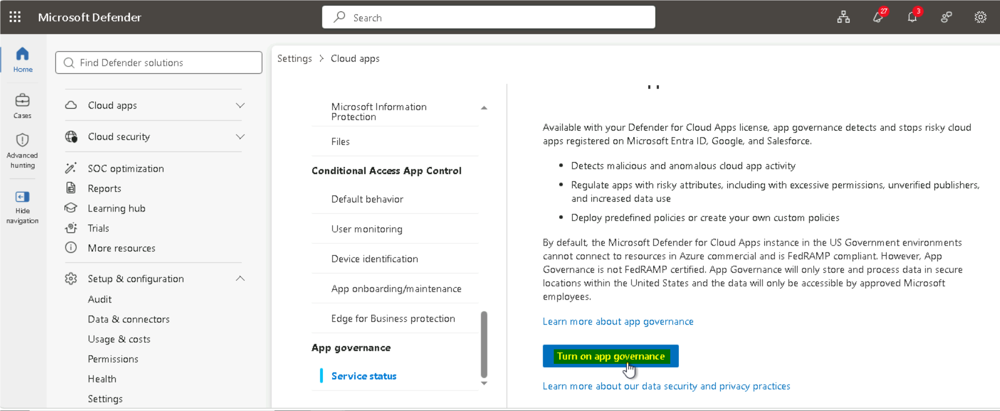
>
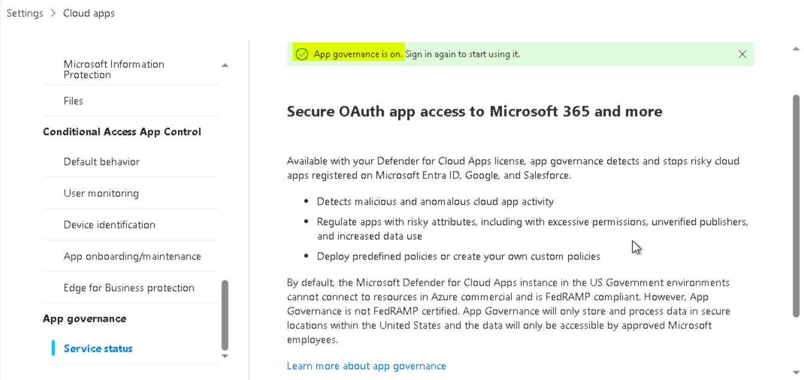

3.  Confirm auditing is on: open https://purview.microsoft.com, open **Audit**, and click **Start recording user and admin activity** if the banner appears. Since we have already enabled audit in the previous lab, the option might not be visible here.

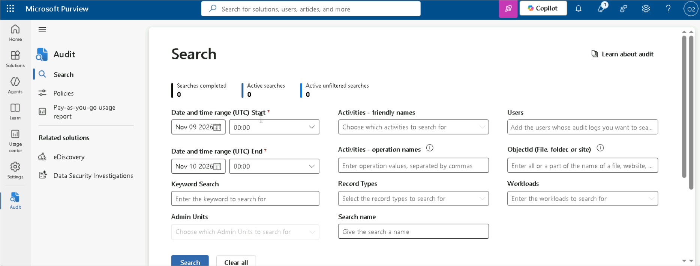

**Note** - The Microsoft 365 app connector in Exercise 5 needs auditing.

### Task 5: Generate cloud app traffic on the VM

1.  On the VM, open **Microsoft Edge** and visit several cloud storage and file-sharing sites, for example https://www.dropbox.com, https://www.box.com, https://wetransfer.com, https://drive.google.com and https://www.mediafire.com. Browse each site for a few seconds.

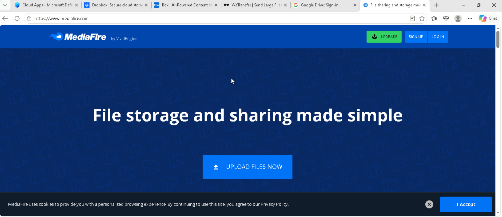

## Exercise 2: Discover Shadow IT

Cloud Discovery builds a picture of app usage from the traffic Defender reports from your devices.

### Task 1: Review discovered apps

1.  In the Defender portal, go to **Cloud Apps \> Cloud Discovery**.

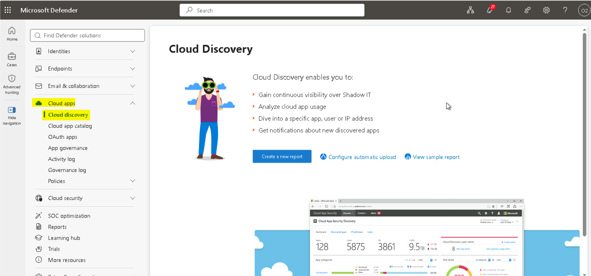
>
> **Note:** If you see the **Cloud Discovery enables you to:** welcome page with **Create a new report** and **Configure automatic upload**, no discovery data has arrived from Defender for Endpoint yet. Don’t use either button. Data can take up to 2 hours to appear after Exercise 1. Check the items below, then continue with Exercise 3 and come back later.

2.  Once data has arrived, the **Cloud Discovery** dashboard opens. At the top right, open the data source list and select **Win10 Endpoint Users** (shown as **Defender-managed endpoints** in newer tenants).

3.  Review the **Dashboard**: discovered apps, IP addresses, users, devices and app categories.

4.  Select the **Discovered apps** tab. Filter by **App category** **Cloud storage** and sort by **Risk score**.

5.  Select **WeTransfer** (or another discovered app) and review its risk factors: **General**, **Security**, **Compliance** and **Legal**.

### Task 2: Assess apps in the Cloud app catalog

1.  Go to **Cloud Apps \> Cloud app catalog** and search for **Dropbox**. Open it and compare its risk score and certifications with WeTransfer.

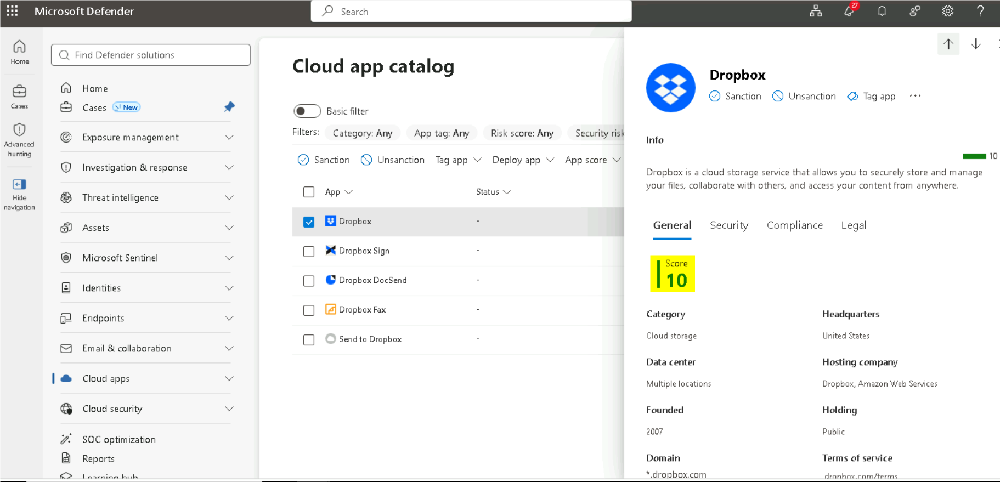
>
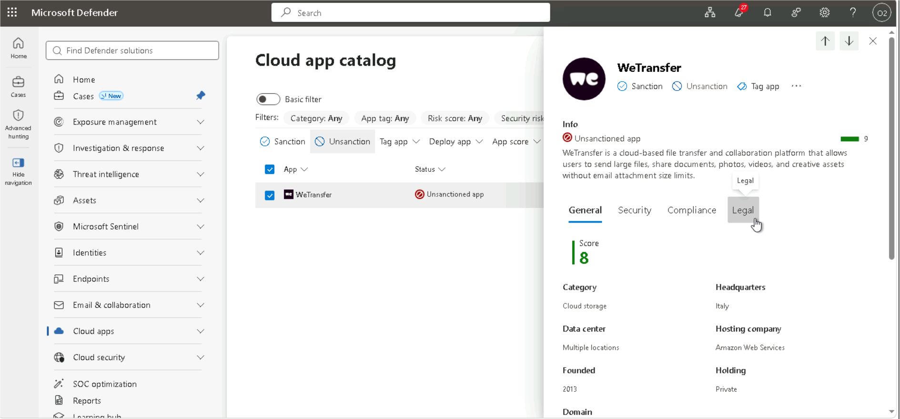

2.  Note the score is on a scale of 1 (high risk) to 10 (low risk). Apps below your organization's threshold are candidates to block.

## Exercise 3: Govern Discovered Apps

**Time - 15 minutes**

Tagging an app as **Unsanctioned** makes Defender for Endpoint block it on every onboarded device. **Monitored** shows a warning that users can bypass.

### Task 1: Sanction, monitor, and block apps

1.  In **Cloud Apps \> Cloud app catalog** ,search for **OneDrive** and select **Sanctioned** from the app's **...** menu.

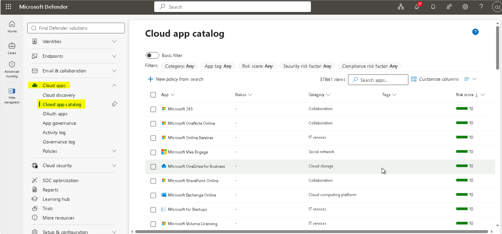

2.  Search for **Dropbox** and tag it as **Monitored**.

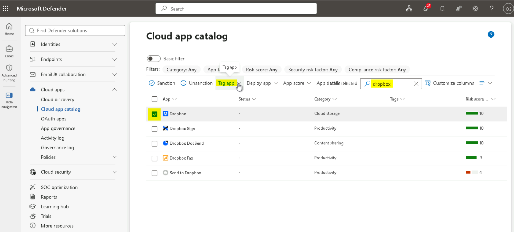
>
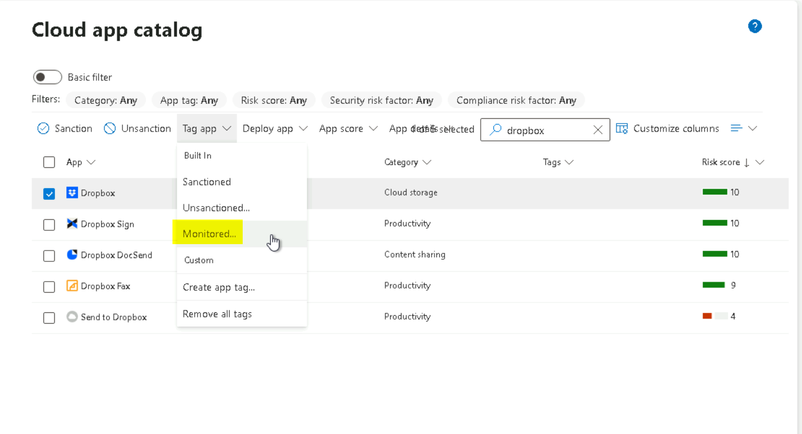

3.  Search for **WeTransfer** and tag it as **Unsanctioned**. In the **Tag as unsanctioned?** dialog, click **Save** to apply it to all devices.

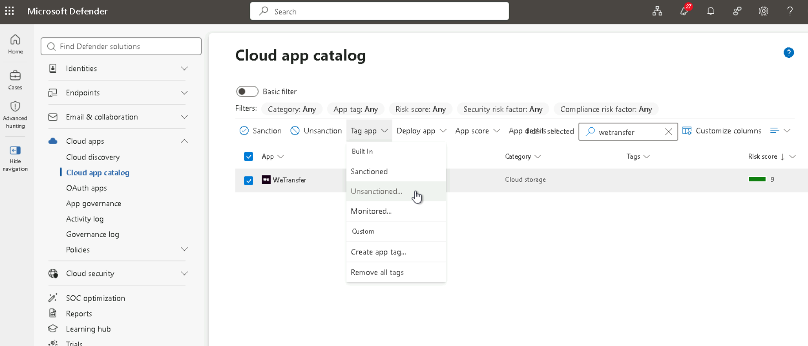
>
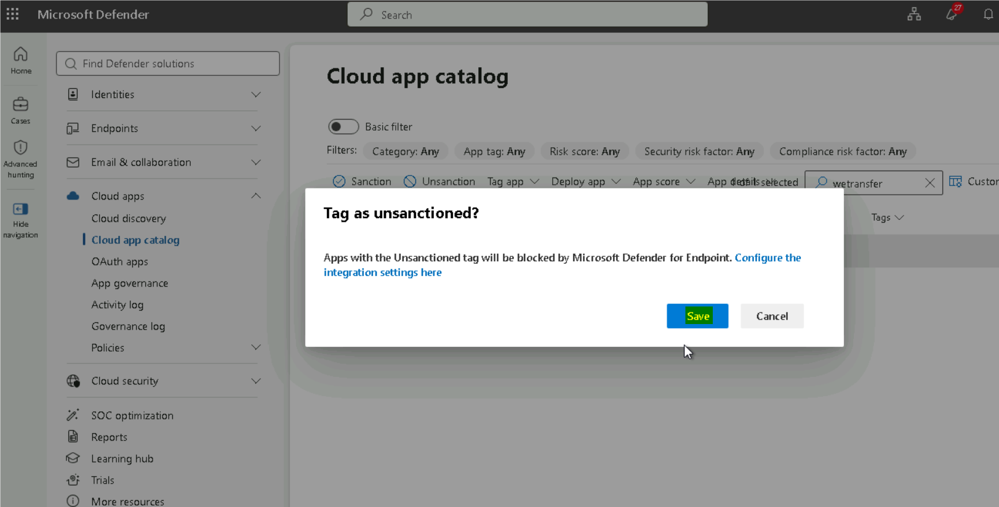
>
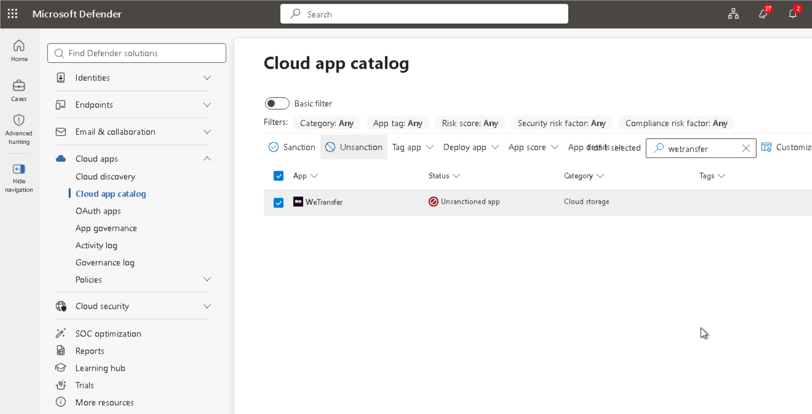

### Task 2: Configure the user experience

1.  Go to **Settings \> Cloud Apps \> Cloud Discovery \> Microsoft Defender for Endpoint**.

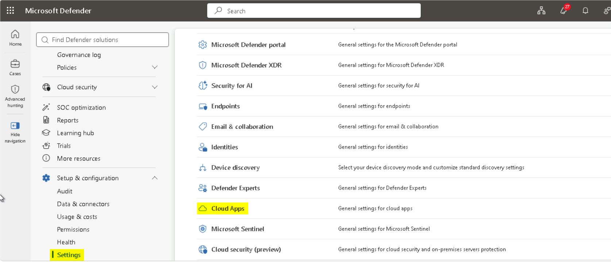

2.  Under User notifications, fill in the following:

> Notification URL: enter https://www.microsoft.com. Users who open a Monitored app see a warning with this link and can choose to continue.
>
> Bypass duration: enter 1 hours. After a user bypasses the warning, it reappears after this many hours.
>
> Notification URL for blocked apps: enter https://www.microsoft.com. Users who try to open an Unsanctioned app see a block page with this link.
>
> Click **Save**.
>
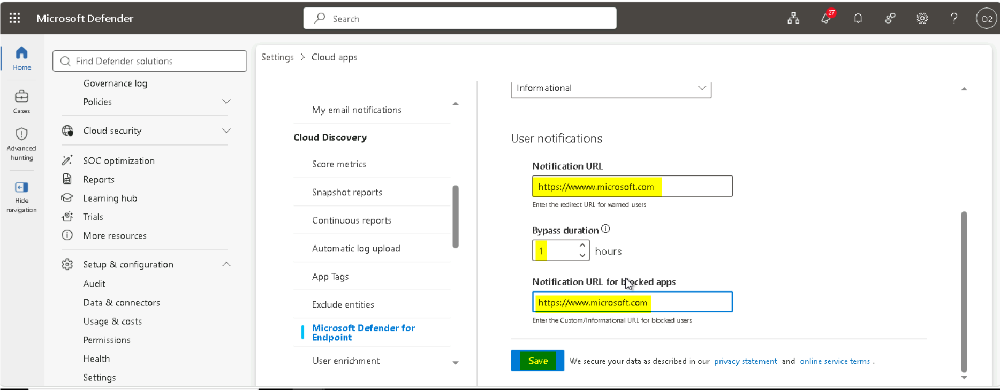

### Task 3: Verify enforcement

1.  Go to **Settings \> Endpoints \> Indicators** and select the **URLs/Domains** tab. Confirm that Defender for Cloud Apps created block indicators for the WeTransfer domains.

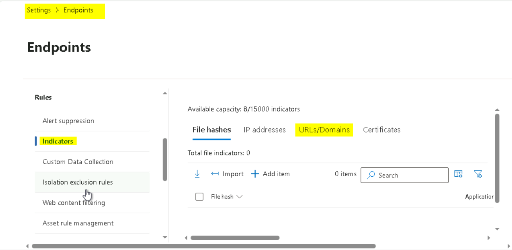
>
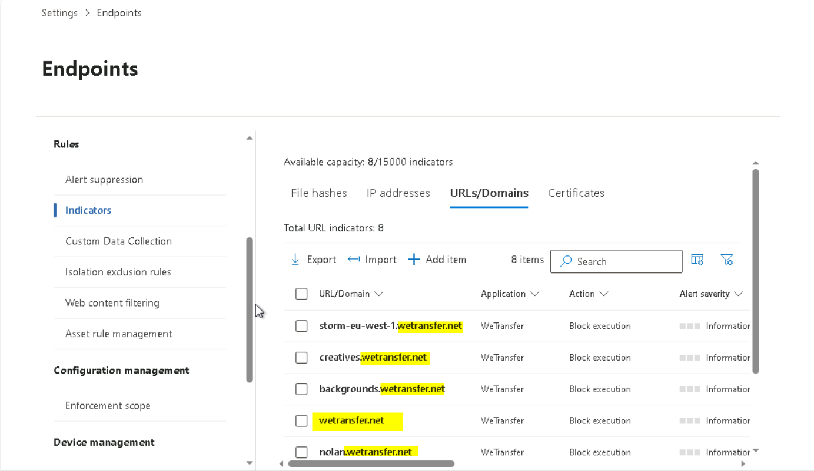
>
> **Note** - Syncing tags to Defender for Endpoint can take up to 1 hour, and pushing them to devices up to 2 more hours.

2.  On the VM, open https://wetransfer.com in **Microsoft Edge**. When enforcement has reached the device, the page is blocked by Microsoft Defender SmartScreen.

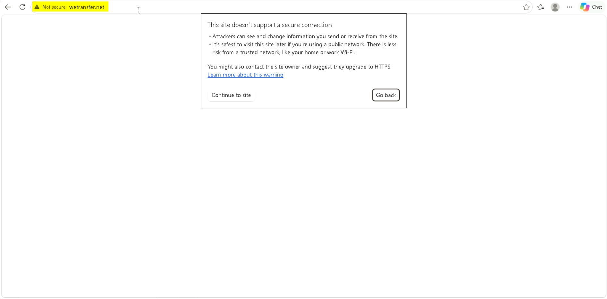
>
> **Note** - In other browsers, network protection shows a Windows notification instead of a block page.

## Exercise 4: Govern OAuth Apps with App Governance

**Time - 10 minutes**

App governance monitors OAuth apps registered in or consented to by your tenant, flags apps that are overprivileged or behave unusually, and can disable them automatically.

### Task 1: Review app governance

1.  Go to **Cloud Apps \> App governance**. On the **Overview** tab, review **Overprivileged apps**, **Active incidents** and **Total Graph API data access**.

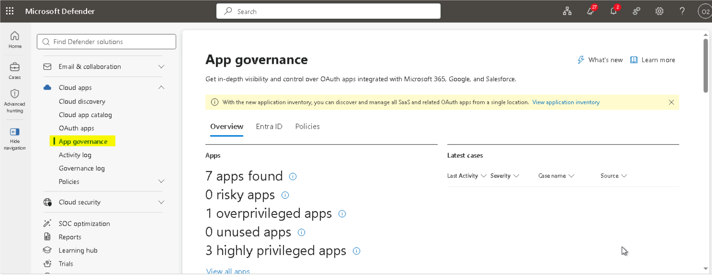
>
> **Note** - If app governance is not ready yet (it can take up to 10 hours), read through this exercise and complete it later in the day.

2.  Select the **Entra ID** (Microsoft Entra) apps tab. Sort by **Permission usage** or **Privilege level** and open an app to see its permissions, consents, and which permissions are unused.

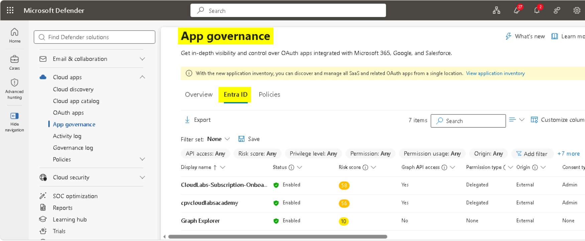

3.  Select the **Policies** tab and review the predefined policies that are active by default. Click **Create new policy**, choose a template such as **New app with high privileges** (or similar), name it **L10-High-Privilege-New-Apps**, set the status to **Audit mode**, and create it.

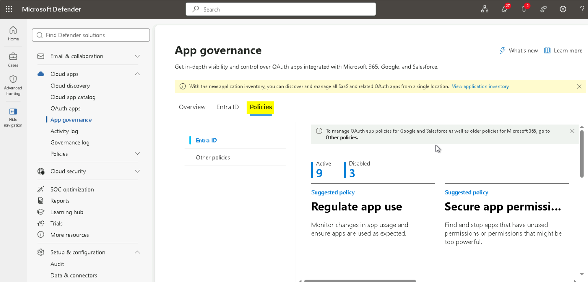

## Exercise 5: Connect Microsoft 365 to Defender for Cloud Apps

**Time - 10 minutes**

The Microsoft 365 app connector gives Defender for Cloud Apps the activity and file data it needs for threat detection and information protection in Microsoft 365.

### Task 1: Connect the Microsoft 365 app connector

1.  Go to **Settings \> Cloud Apps \> Connected apps \> App Connectors**. If **Microsoft 365** is already listed as **Connected**, skip to step 4.

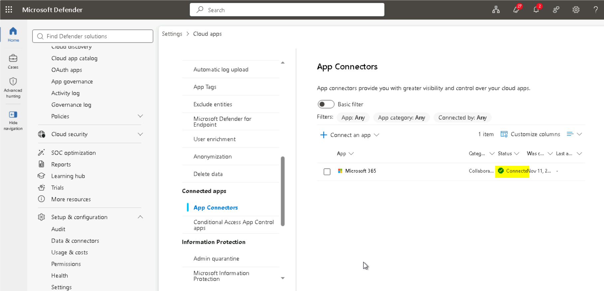

2.  Click **+ Connect an app** and select **Microsoft 365**.

3.  On **Select Microsoft 365 components**, keep all components selected and click **Connect**, then click **Connect Microsoft 365** and **Done**.

4.  Confirm the **Microsoft 365** connector status is **Connected**.

## Exercise 6: Configure Threat Detection Policies

**Time - 15 minutes**

Defender for Cloud Apps includes built-in anomaly detection policies, such as impossible travel, that use behaviour analytics. You can also create your own activity policies from templates.

### Task 1: Review built-in anomaly detection policies

1.  Go to **Cloud Apps \> Policies \> Policy management** and select the **Threat detection** tab.

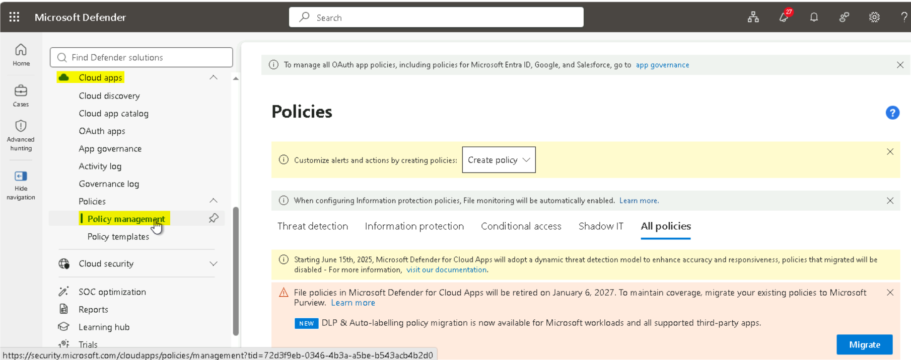

2.  Open **Impossible travel**. Review the scope and sensitivity settings, set **Sensitivity** to **Medium**, and click **Update**.

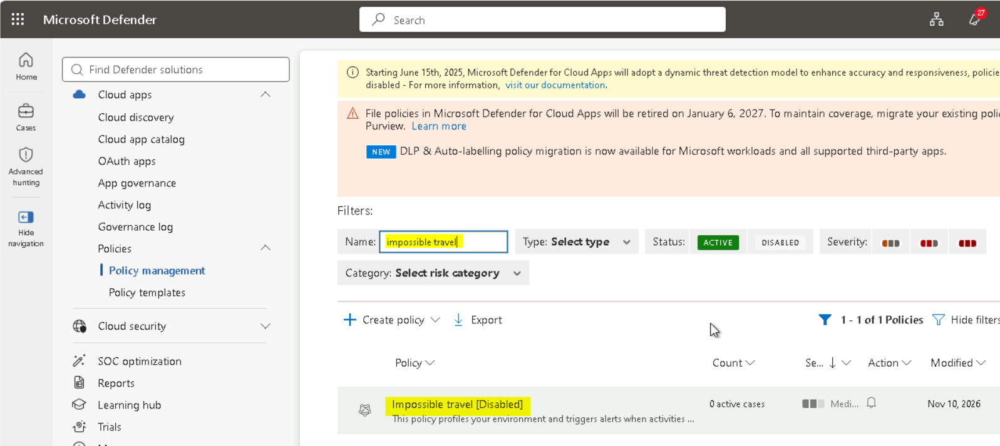
>
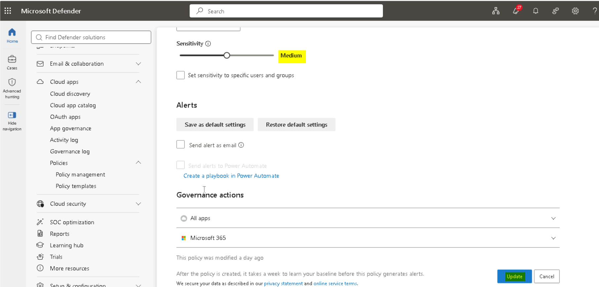
>
> **Note** - Anomaly detections need a learning period of up to 7 days before they start alerting.

3.  Review the other built-in policies, such as **Activity from infrequent country**, **Mass download by a single user** and **Suspicious inbox manipulation rule**.

### Task 2: Create an activity policy from a template

1.  Click **+ Create policy** and select **Activity policy**.

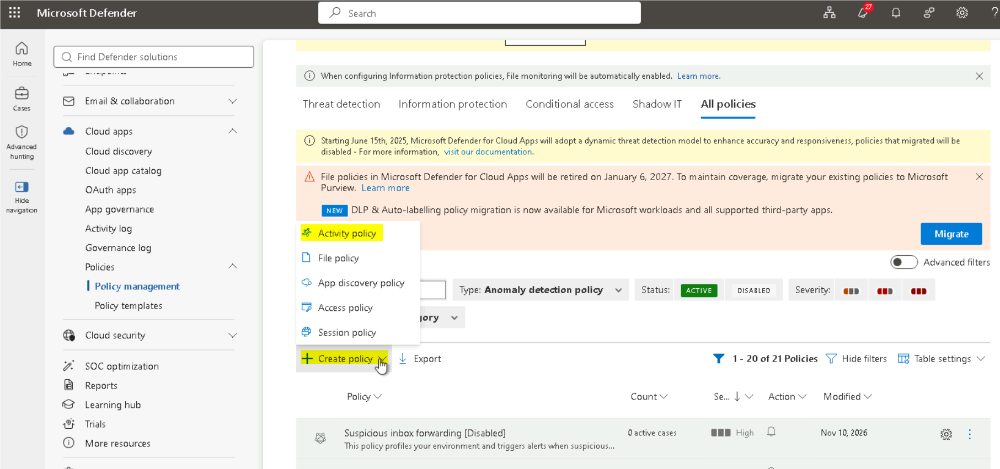

2.  From **Policy template**, choose **Logon from a risky IP address** (or **Administrative activity from a non-corporate IP address**) and click **Apply template**.

3.  Rename the policy **L10-Risky-IP-Logon**, set **Policy severity** to **High**.

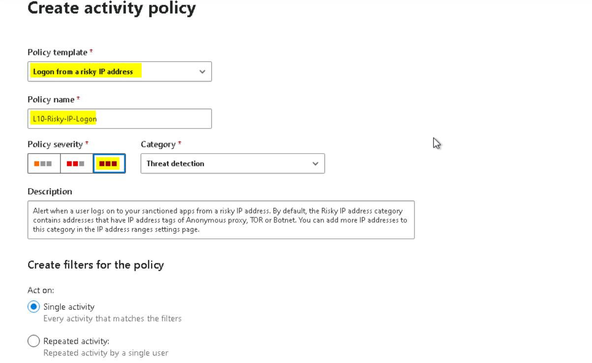

4.  Under **Alerts** select **Send alert as email** to your address.

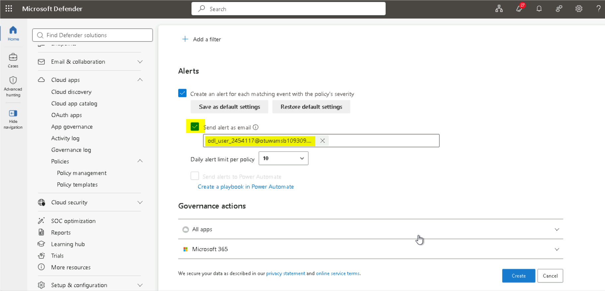

5.  Under **Governance actions**, review the actions available for **Microsoft 365** (such as **Suspend user**) but don't select any. Click **Create**.

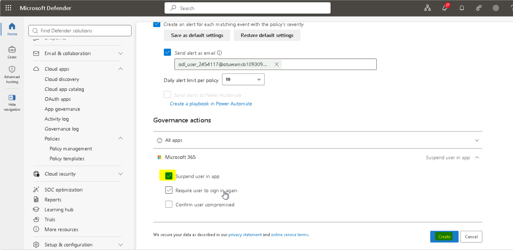
>
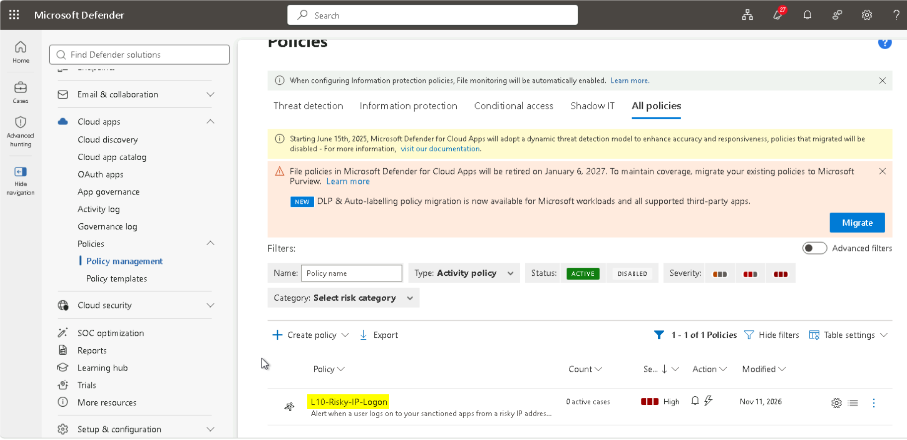

## Summary

In this lab you onboarded a device and connected Defender for Endpoint to Defender for Cloud Apps, discovered and assessed cloud apps, sanctioned, monitored and blocked apps with network protection, turned on app governance and created an OAuth app policy, connected Microsoft 365, and tuned and created threat detection policies.

## Clean up resources

1.  Remove the **Unsanctioned** tag from **WeTransfer** if you want the site to be available to other labs.

2.  Leave the device onboarded and the other settings in place; they do not affect other labs.
