# Lab 14: Activate Data Security Posture Management (DSPM)

## Objectives

Microsoft Purview Data Security Posture Management (DSPM) gives one view of where sensitive data is, how it is used by people, apps and AI agents, and which risks need attention. It organizes work into data security objectives with remediation plans and one-click policies. In this lab you will activate DSPM, review posture and objectives, apply a one-click policy, run a data risk assessment for oversharing, and review AI observability, activity and reports.

- Activate DSPM and complete the initial setup tasks

- Review the posture dashboard and data security objectives

- Apply a one-click policy from an objective's remediation plan

- Run a data risk assessment to find oversharing

- Review AI observability, Activity explorer and reports

**Prerequisites**

A lab administrator account with the **Compliance Administrator** or **Global Administrator** role.

Microsoft 365 Business Premium plus the Purview Suite (or Microsoft 365 E5).

**This lab is self-contained. It does not depend on any other lab in the course; Exercise 1 creates everything the lab needs. If an object already exists in your tenant (for example because another lab created it earlier today), skip that step.**

**DSPM needs time to collect data: allow about a day after activation before most dashboards show results. In a new lab tenant expect many pages to be empty; focus on where each control is and what it does.**

## Exercise 1: Prepare the Lab Environment

**Time - 10 minutes**

### Task 1: Turn on auditing

1.  Open the Microsoft Purview portal at https://purview.microsoft.com, select **Solutions \> Audit**. If a banner prompts you to **Start recording user and admin activity**, click it. If no banner appears, auditing is already on.

> **Note** - Auditing can take up to 60 minutes to start. Continue with the lab; later steps that need audit data say so.

### Task 2: Create sample sensitive content

DSPM needs some sensitive data to find. You create a file and share it broadly to simulate oversharing.

1.  Open OneDrive on the web (https://www.office.com \> **OneDrive**) as the lab administrator and create a new Word document named **L14-Payroll-Sample**.

2.  Type a few lines such as **Employee: Jane Doe, Card: 4111 1111 1111 1111, SSN: 078-05-1120** and close the document.

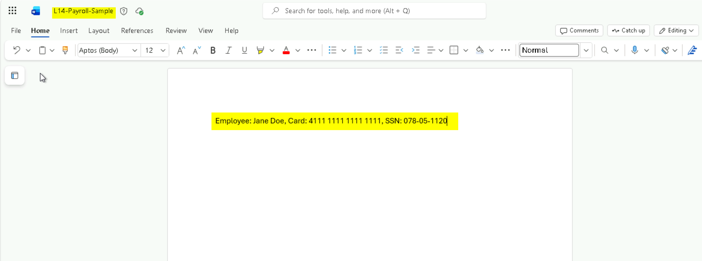
> **Note** - These are publicly documented test values, not real data. If the label doesnot allow pasting, then change the label and paste the sample data.
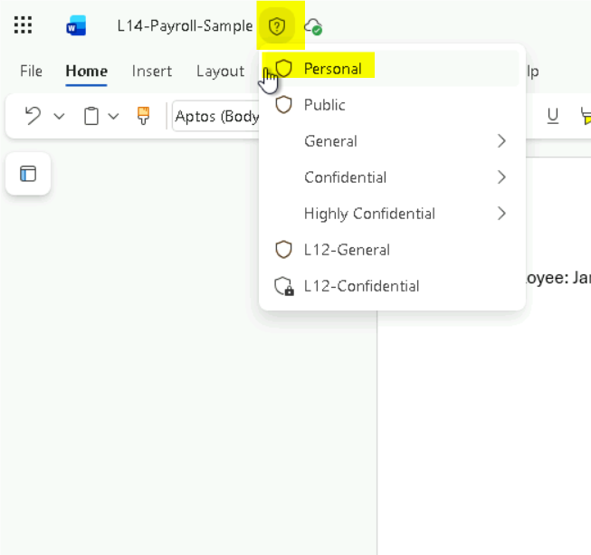

3.  Select the file, click **Share**, choose **People in your organization with the link can view**, and copy the link.

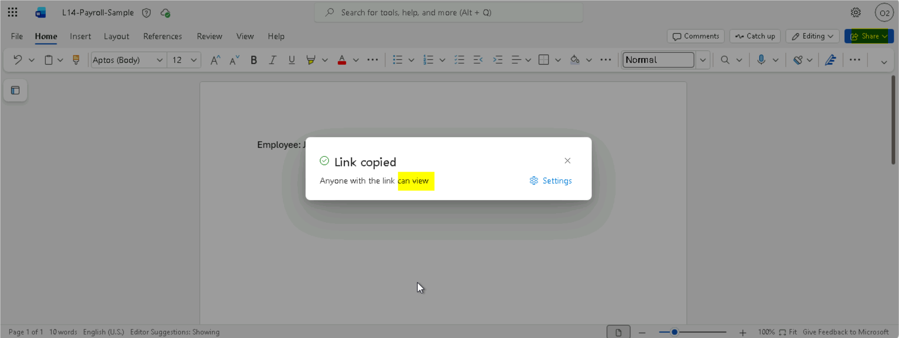

4.  Share the documents link in teams with multiple users

## Exercise 2: Activate DSPM and Review Posture

**Time - 15 minutes**

### Task 1: Open DSPM and accept setup tasks

1.  In the Purview portal (https://purview.microsoft.com), go to **Solutions \> DSPM**.

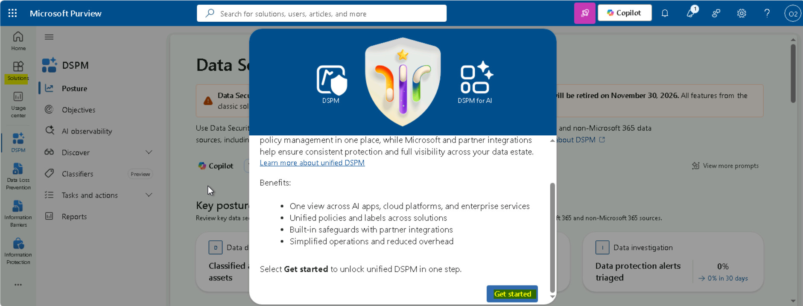

**Note** - Make sure you open **DSPM**, not **Data Security Posture Management (classic)** or **DSPM for AI (classic)**.

2.  If prompted, review the initial setup tasks (for example turning on analytics and collection policies) and accept them.

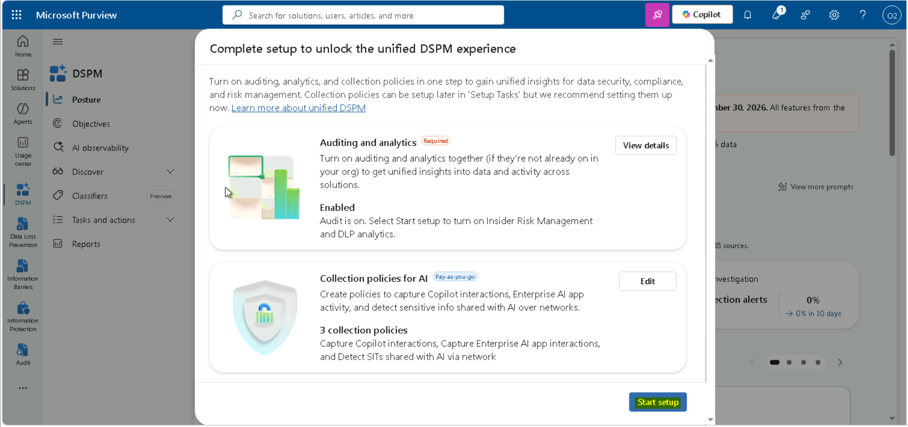
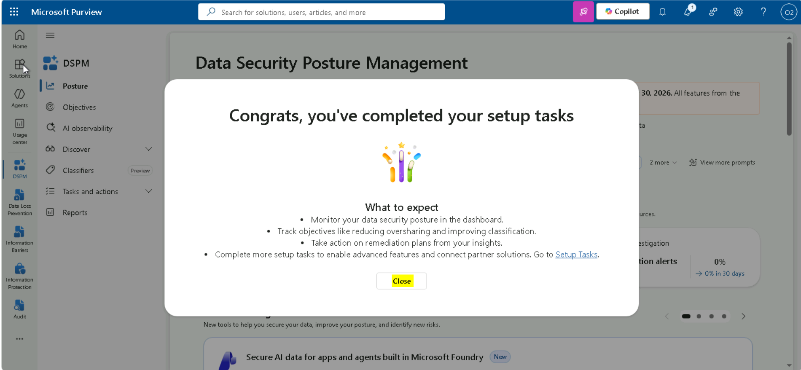

3.  On **Posture**, review the **key posture metrics**, **top objectives by risk**, the snapshot of data use, and the 30-day trend.

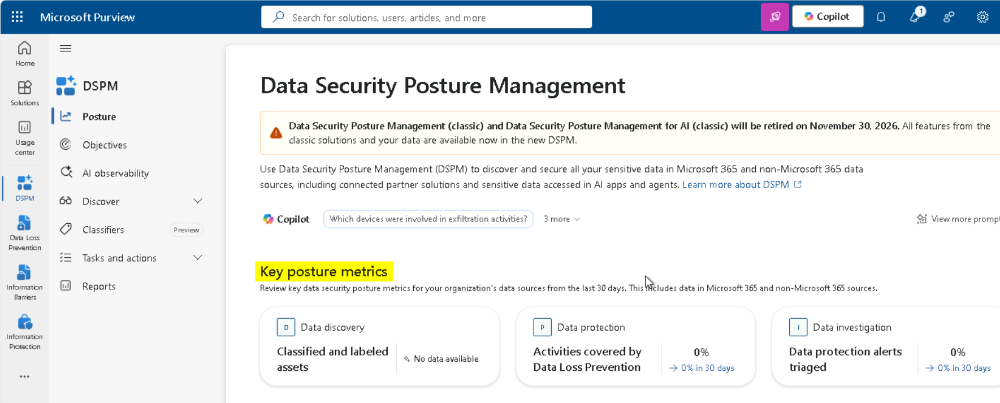
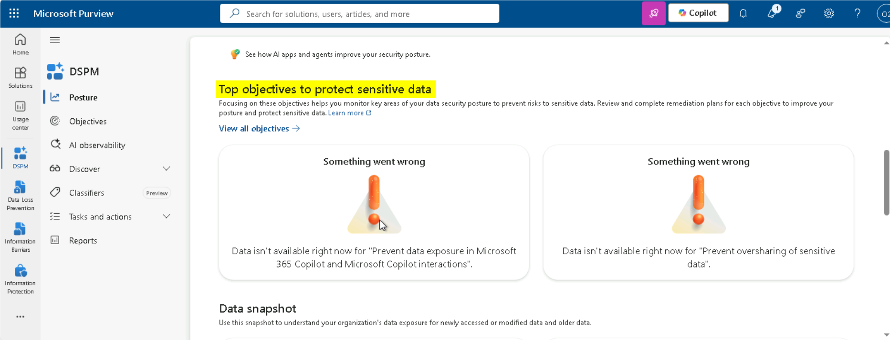

### Task 2: Review objectives

1.  Select **Objectives**. Review the data security objectives, such as **Prevent oversharing of sensitive data**, **Prevent exfiltration to risky locations** and **Discover sensitive data in your organization**.

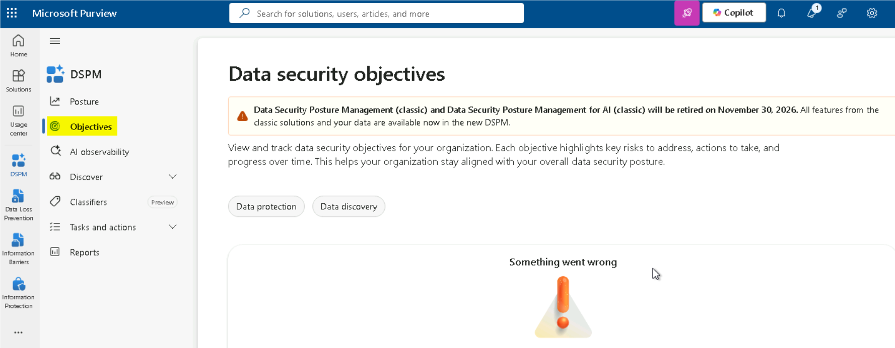

2.  Open **Prevent oversharing of sensitive data** and review its **remediation plan**: the recommended actions and the one-click policies it offers.

> **Note:** In this lab tenant, DSPM cards may show **Something went wrong** or **Data isn’t available right now**. DSPM needs audit data and classification results, which can take 24–48 hours to build up. Focus on where each feature is and how it’s configured.

## Exercise 3: Find Oversharing with a Data Risk Assessment

**Time - 15 minutes**

Data risk assessments scan SharePoint and OneDrive for sensitive content that is shared too widely, for example with organization-wide or anyone links.

### Task 1: Review and run an assessment

1.  Select **Discover \> Data risk assessments**. Review the **default** assessment, which covers the most active SharePoint sites.

2.  Click **+ Create custom assessment** (shown as **Create assessment** in some tenants). Enter **L14-OneDrive-Oversharing**, select your lab administrator's OneDrive as the scope, and click **Run** (or **Create**).

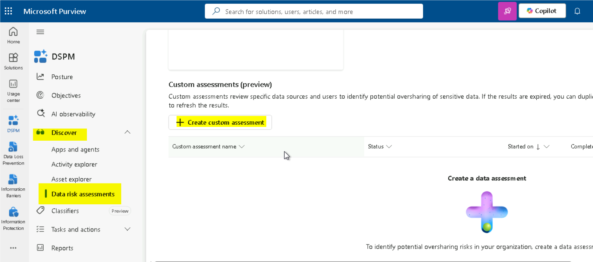
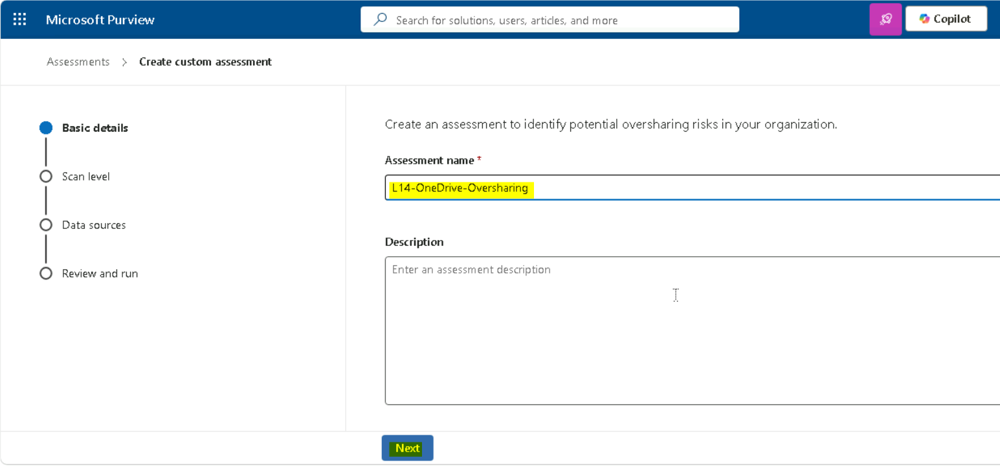
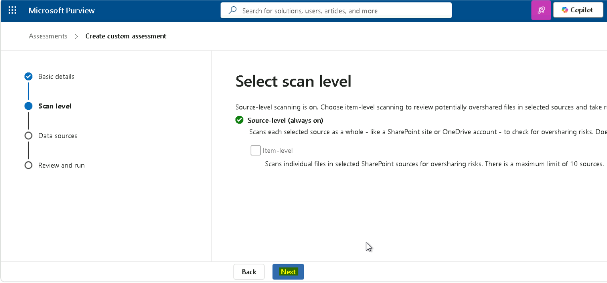
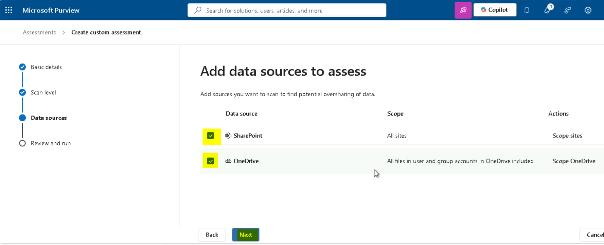
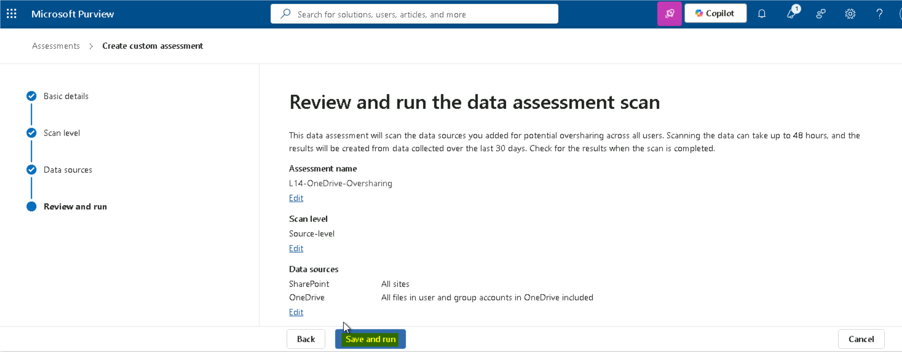

**Note** - Assessments can take several hours to complete. Return to it later to review results.

3.  When results are available, open the assessment and review items with sensitive data and the sharing links that expose them (for example **L14-Payroll-Sample**). Review the remediation options, such as removing sharing links or applying a label.

## Exercise 4: Review AI Observability, Activity and Reports

### Task 1: Review AI observability

1.  Select **AI observability**. Review the inventory of AI apps and agents active in the last 30 days, the number that are high risk, and those with sensitive interactions.

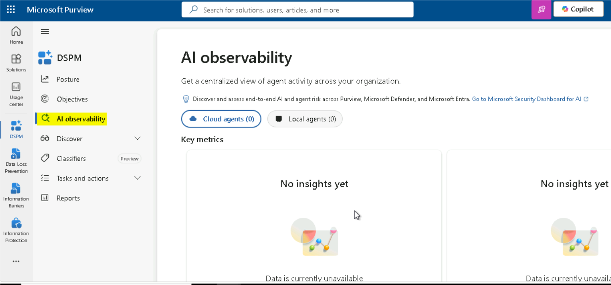
> **Note** - In a new tenant without Copilot or agents this page may be empty. Lab 18 covers agents in more detail.

2.  Select **Discover \> Apps and agents** and review the AI apps and agents used across the organization.

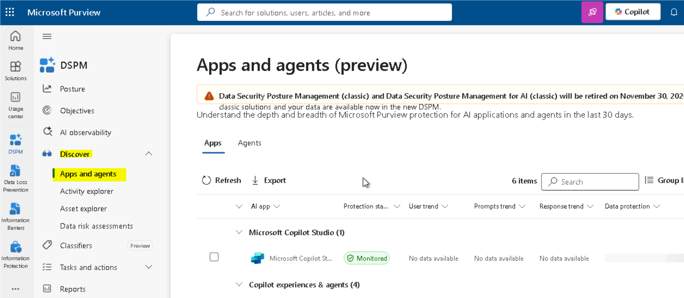

### Task 2: Review activity and reports

In this task you explore the DSPM pages that show how data is being used. Your lab tenant is new and has almost no user activity, Copilot interactions or classified content yet, so **Activity explorer**, **Asset explorer** and **Reports** may be empty or show **Data isn’t available right now**. That’s expected in a test environment. DSPM builds this data from audit logs and classification results, which take 24–48 hours to build up. Treat this task as a guided tour: get to know where each page is, what it reports, and which filters you would use in a production tenant to investigate risky activity.

1.  Select **Discover \> Activity explorer**. Review activities on sensitive and labeled content, then open the **AI activities** tab for prompts, responses and DLP matches.

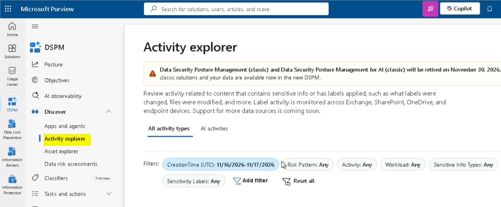

2.  Select **Reports** and review the sensitive data usage and labeling, policy usage, and risky user and agent behavior reports.

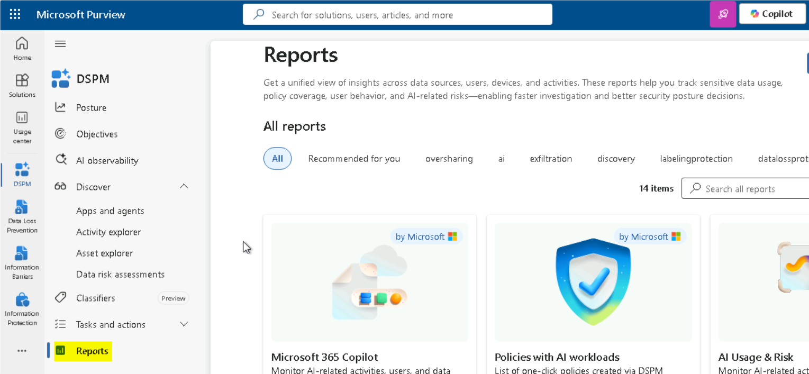

3.  Select **Asset explorer** and review the **Standard** tab for unlabeled or classified data by workload.

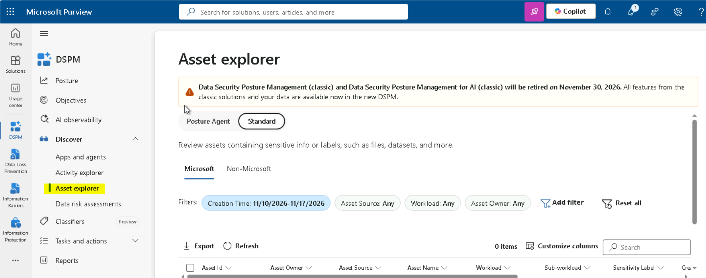

## Summary

In this lab you activated DSPM, reviewed posture and data security objectives, applied a one-click policy, ran a data risk assessment to find oversharing, and reviewed AI observability, Activity explorer, Asset explorer and reports.

## Clean up resources

1.  Remove the organization-wide sharing link from **L14-Payroll-Sample** or delete the file. Leave the one-click policy in simulation mode or turn it off.
