# Lab 15: Configure Least-Privilege Access Control for Microsoft Agent 365

## Objectives

Microsoft Agent 365 gives administrators one control plane to see, govern and secure AI agents. Only Global Administrators and AI Administrators can take governance actions such as approving agent requests or assigning owners; other roles can view agents but not change them. In this lab you will license Agent 365, delegate agent administration with least-privilege roles, verify what each role can do, and tighten user consent so agents cannot be granted access to company data without admin approval.

- Assign the Agent 365 licence and open the Agents area of the Microsoft 365 admin center

- Create an AI Administrator and an AI Reader for least-privilege agent management

- Verify the difference between administrator and reader access

- Require admin consent for apps and agents that request access to company data

**Prerequisites**

A lab administrator account with the **Global Administrator** role.

At least one **Microsoft Agent 365** licence (or Microsoft 365 E7) in the tenant.

**This lab is self-contained. It does not depend on any other lab in the course; Exercise 1 creates everything the lab needs. If an object already exists in your tenant (for example because another lab created it earlier today), skip that step.**

**Agent 365 is new and evolving quickly. Menu names in this lab can differ slightly in your tenant; use the closest match.**

## Exercise 1: Prepare the Lab Environment

**Time - 15 minutes**

### Task 1: Assign the Agent 365 licence

1.  In the Microsoft 365 admin center (https://admin.microsoft.com), go to **Billing \> Licenses**, open **Agent 365** (or **Microsoft Agent 365**), and confirm a licence is assigned to your lab administrator. If not, click **Assign licenses**, add your lab administrator, and click **Assign**.

> **Note** - Agent 365 features can take up to a few hours to appear after the licence is assigned. Agent 365 is evolving quickly; menu names in this lab may differ slightly in your tenant.

### Task 2: Create two delegated administrators

1.  In the Entra admin center (https://entra.microsoft.com), go to **Entra ID \> Users \> All users \> + New user \> Create new user**. Create **l15aiadmin** (**Display name** **L15 AI Admin**) with the following password **P@55w.rd1234**.

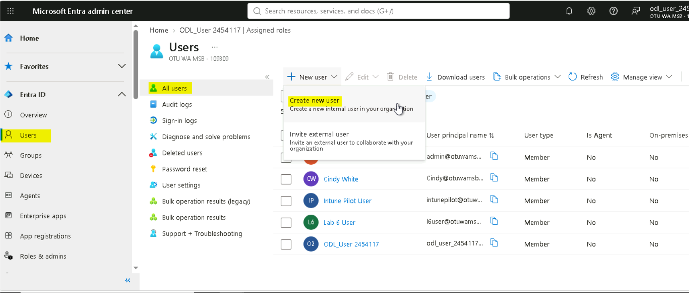

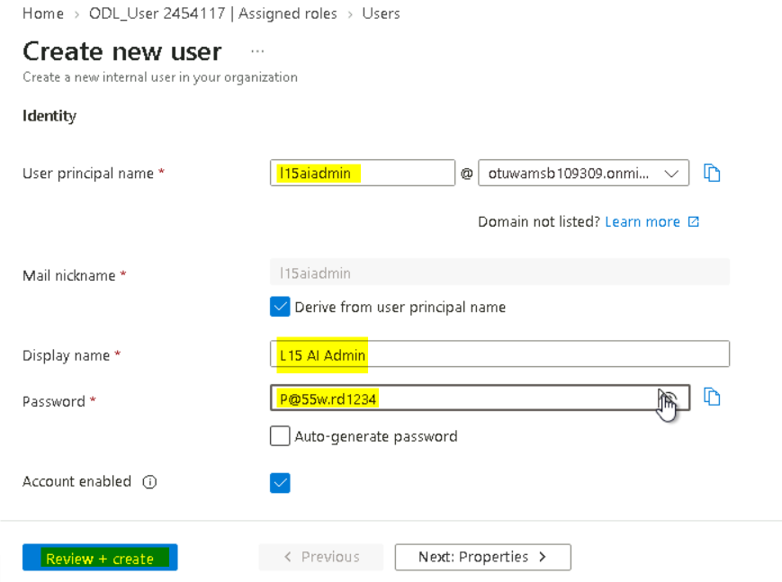

2.  Similarly, create a second user **l15aireader** (**Display name** **L15 AI Reader**) with a password you record.

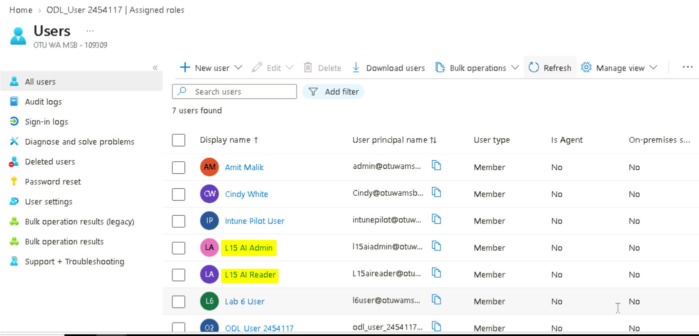

**Note** - These accounts don't need licences to sign in to admin centers.

## Exercise 2: Explore Agent 365 in the Microsoft 365 Admin Center

### Task 1: Review the agent overview

1.  In the Microsoft 365 admin center, go to **Agents \> Overview**. Review the agent counts, governance gaps (for example agents without owners), pending requests, and agents flagged with risks by Microsoft Entra, Defender or Purview.

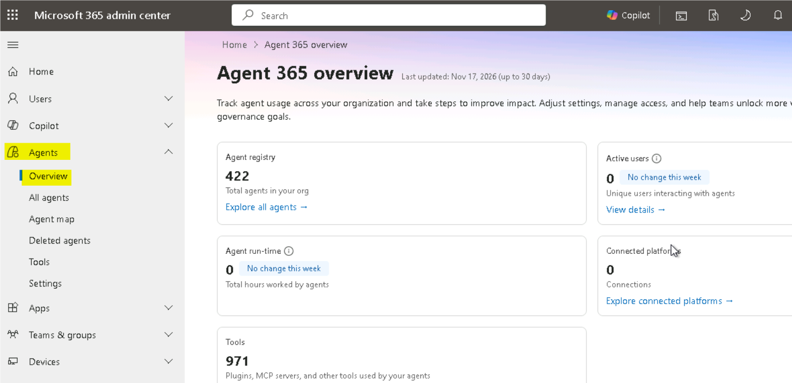

2.  Select **All agents** and review the **Registry** view: platform, publisher, status and owner of each agent.

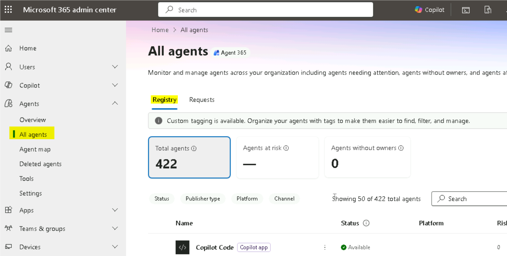

3.  Select the **Requests** tab and review any pending requests to activate or publish agents.

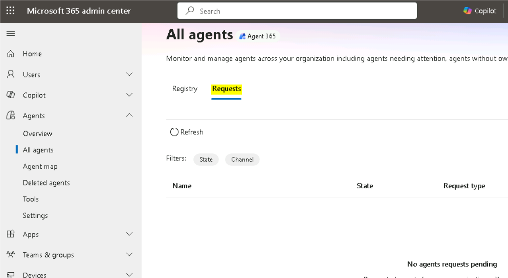

## Exercise 3: Delegate Agent Administration with Least Privilege

Use **AI Administrator** for people who govern agents day to day, and **AI Reader** or **Global Reader** for people who only monitor. Keep Global Administrator for emergencies.

### Task 1: Assign the roles

1.  In the Entra admin center, go to **Entra ID \> Roles & admins \> Roles & admins**, search for **AI Administrator**, and open it.

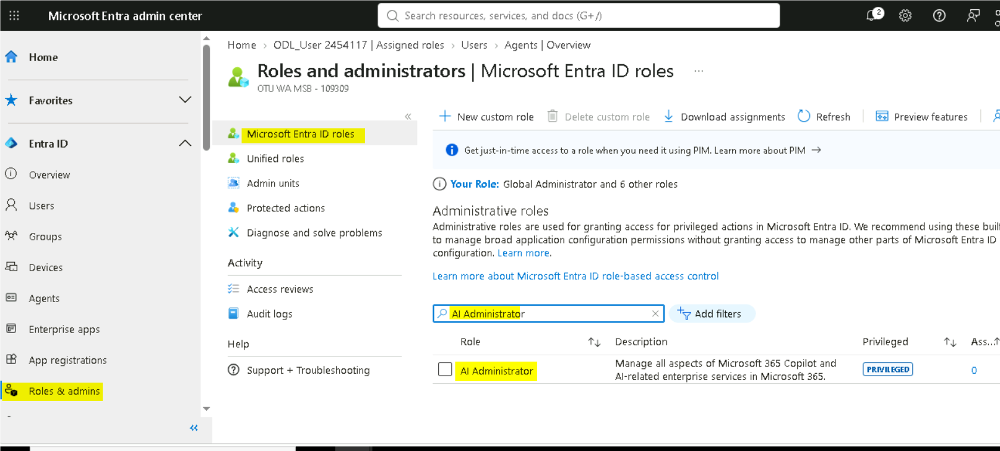

2.  Click **+ Add assignments**, select **L15 AI Admin**, click **Next**, set **Assignment type** to **Active**, enter the justification **Agent governance**, and click **Assign**.

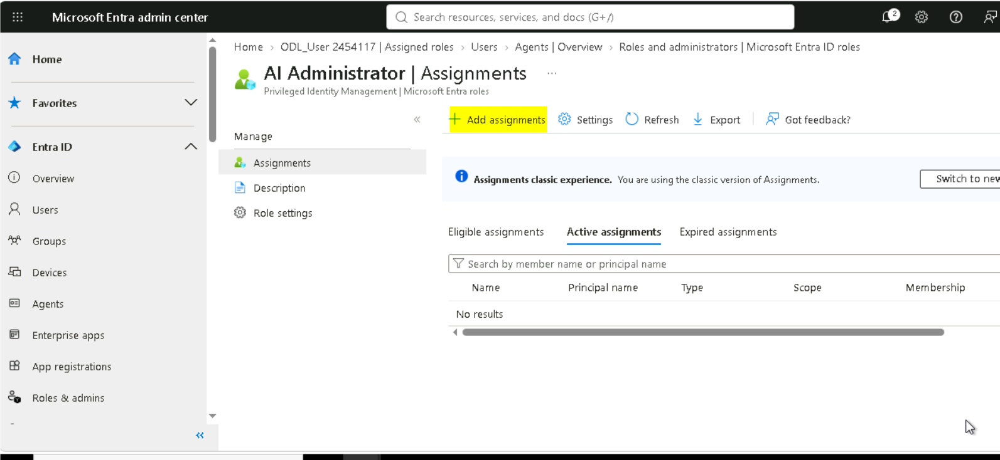

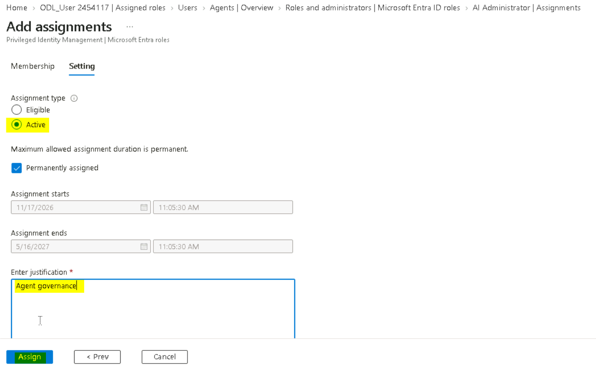

**Note** - In production, make this role **Eligible** with Privileged Identity Management so it's activated just in time.

3.  Return to **Roles & admins**, open **AI Reader**, and assign it to **L15 AI Reader** the same way.

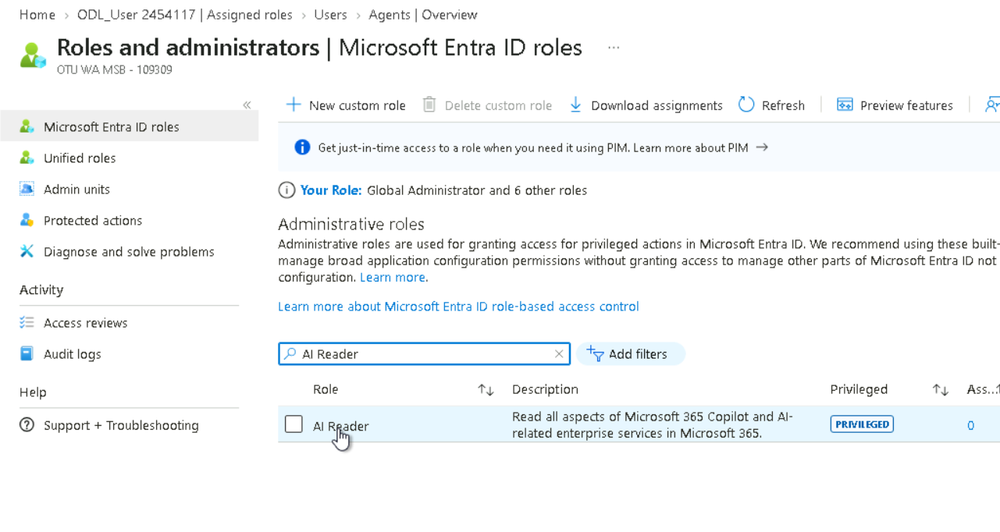

### Task 2: Verify the reader's access

1.  Open an InPrivate window, sign in to https://admin.microsoft.com as **l15aireader**, and go to **Agents \> All agents**.

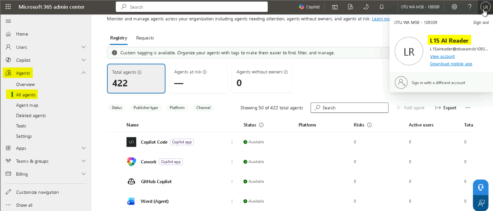

2.  Select an agent and confirm the governance actions (**Block**, **Assign new owner**, **Delete agent**) are unavailable or greyed out. Close the window.

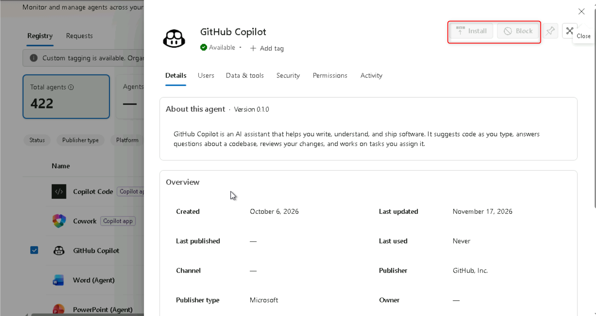

### Task 3: Verify the AI Administrator's access

1.  Open a new InPrivate window, sign in as **l15aiadmin**, and go to **Agents \> All agents**.

2.  Select an agent and confirm governance actions such as **Block** and **Assign new owner** are available. Don't change anything. Close the window.

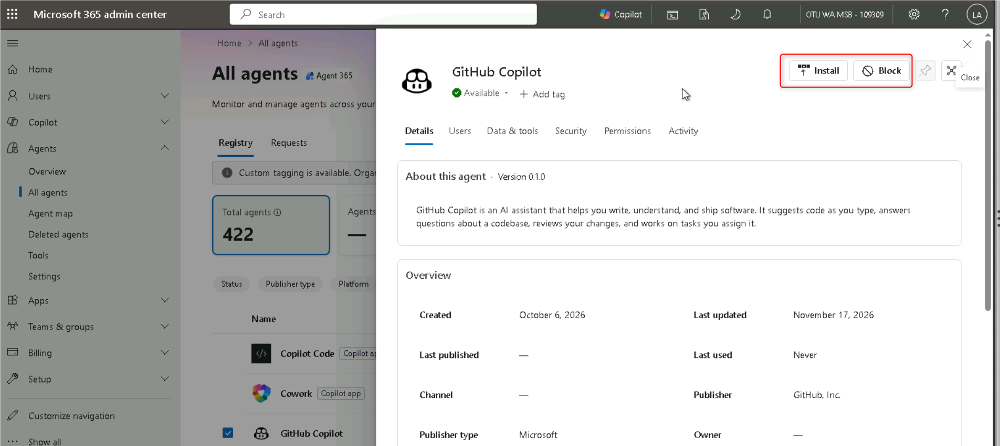

**Note** - AI Administrators can't configure Conditional Access or Entra access package policies; those need a separate, more privileged role.

## Exercise 4: Require Admin Consent for Agent Access

Agents and apps get access to company data through permissions that users or admins consent to. Preventing user consent ensures an admin reviews every request.

### Task 1: Restrict user consent

1.  In the Entra admin center, go to **Entra ID \> Enterprise apps \> Consent and permissions.**

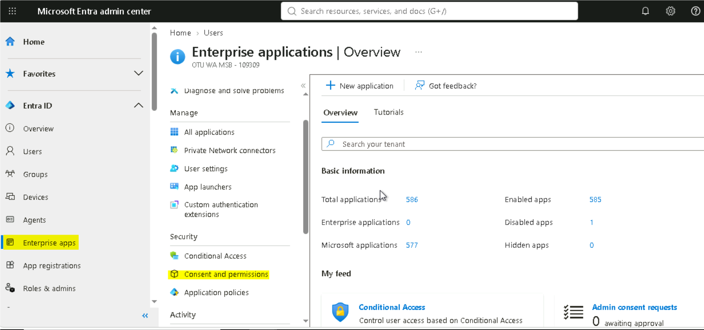

2.  Under **\> User consent settings**, select **Do not allow user consent** (or **Allow user consent for apps from verified publishers, for selected permissions** for a balanced setting) and click **Save**.

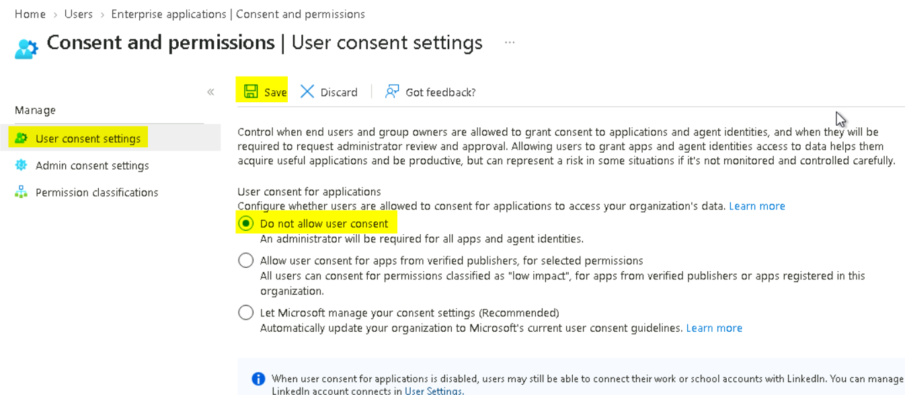

**With user consent blocked, users must request admin approval for new apps and agents.**

### Task 2: Turn on admin consent requests

1.  Go to **Enterprise apps \> Consent and permissions \> Admin consent settings**. Set **Users can request admin consent to apps they are unable to consent to** to **Yes**.

2.  Under **Who can review admin consent requests**, add **L15 AI Admin**. Turn on email notifications and reminders, and click **Save**.

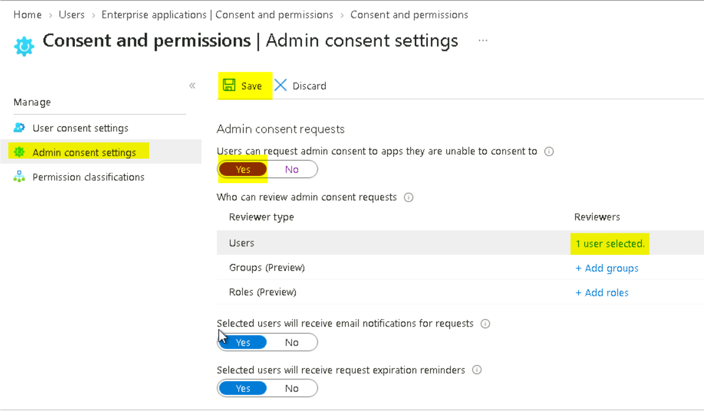

## Summary

In this lab you licensed Agent 365, explored the Agents overview, registry and requests, delegated agent administration with the AI Administrator and AI Reader roles, verified their different access, and required admin approval before agents and apps can be granted access to company data.

## Clean up resources

1.  Delete **l15aiadmin** and **l15aireader**, or remove their roles. Keep the consent settings unless another lab needs user consent.
