# Lab 19: Detect and Remediate Agent Threats with Microsoft Defender

## Objectives

Microsoft Defender extends security operations to AI agents: it discovers agents, assesses their security posture, and detects attacks such as jailbreak attempts, indirect prompt injection, credential leakage and suspicious access. In this lab you will turn on security for AI agents, review the AI agent inventory and posture recommendations, hunt for agent activity, investigate agent alerts, and remediate a risky agent.

- Turn on security for AI agents and connect the Microsoft 365 connector

- Review the AI agent inventory, risk level and security recommendations

- Hunt for agent activity with Advanced hunting

- Investigate agent alerts and incidents

- Remediate a risky agent by blocking it and restricting its identity

**Prerequisites**

A lab administrator account with the **Security Administrator** or **Global Administrator** role.

A **Microsoft Agent 365** licence and Microsoft Defender (included in the Defender Suite or Microsoft 365 E5).

**This lab is self-contained. It does not depend on any other lab in the course; Exercise 1 creates everything the lab needs. If an object already exists in your tenant (for example because another lab created it earlier today), skip that step.**

**Detection of threats to AI agents is in preview. In a new lab tenant there may be no agent alerts; the lab shows where alerts appear and how to respond.**

## Exercise 1: Prepare the Lab Environment

### Task 1: Confirm the Agent 365 licence

1. In the Microsoft 365 admin center (https://admin.microsoft.com), go to **Billing > Licenses**, open **Agent 365** (or **Microsoft Agent 365**), and confirm a licence is assigned to your lab administrator. If not, click **Assign licenses**, add your lab administrator, and click **Assign**.

> **Note** - Agent 365 features can take up to a few hours to appear after the licence is assigned. Agent 365 is evolving quickly; menu names in this lab may differ slightly in your tenant.

### Task 2: Create a test agent

1. Open a new InPrivate window, browse to https://m365.cloud.microsoft/chat and sign in with your lab administrator account.

2. In the left pane select **Agents > New agent**.

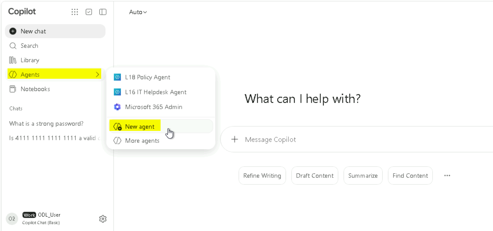

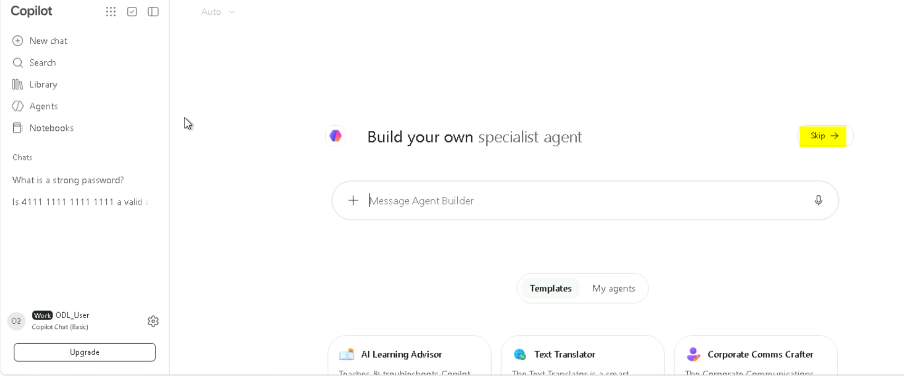

3. On the **Configure** tab, enter **L19 Sales Assistant** as the **Name**, **Answers questions about company IT policies** as the **Description**, and a short instruction such as **Answer IT policy questions politely and say when you do not know.**

4. Click **Create**.

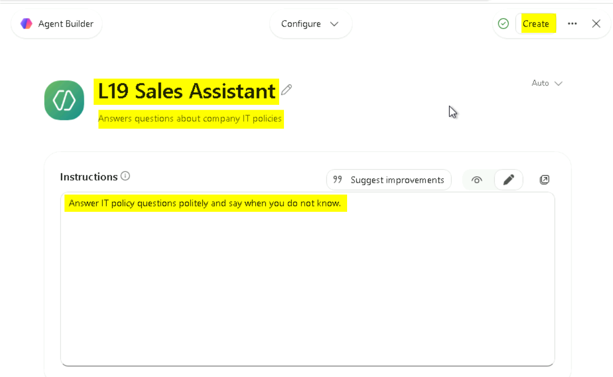

5. When the agent is created, select **Share** and share it with **Org-wide sharing for chat access**, then click **Save**.

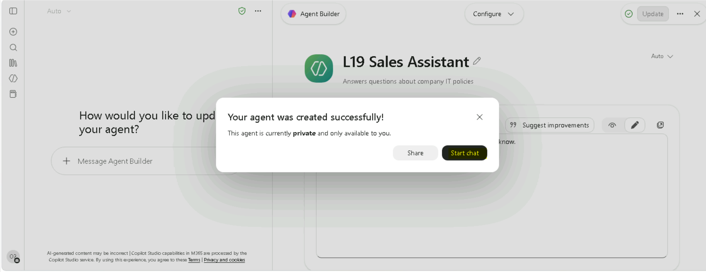

> **Note** - If **New agent** is not available, Agent Builder is turned off or not licensed in your tenant. Use any agent already listed in **Microsoft 365 admin center > Agents > All agents** for the rest of the lab, or follow the instructor demonstration.

6. In the Microsoft 365 admin center (https://admin.microsoft.com), go to **Agents > All agents** and confirm **L19 Sales Assistant** appears in the **Registry** view.

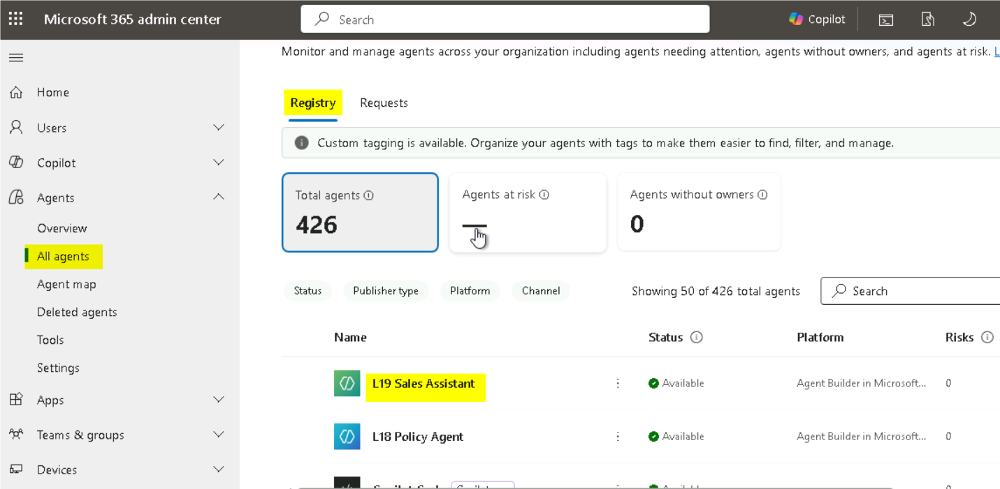

> **Note** - New agents can take up to 30 minutes to appear in the admin center.

## Exercise 2: Turn On Security for AI Agents

### Task 1: Enable the integration

1. On the Defender portal navigate to **Settings > Cloud Apps > Files > Enable file monitoring**

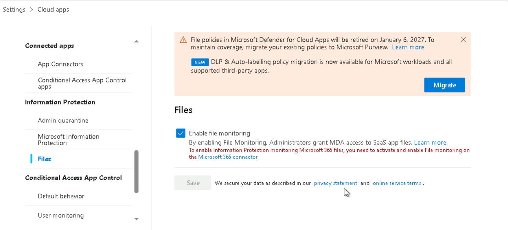

2. In the Microsoft Defender portal (https://security.microsoft.com), go to **Setup > Settings > Security for AI > Get started**.

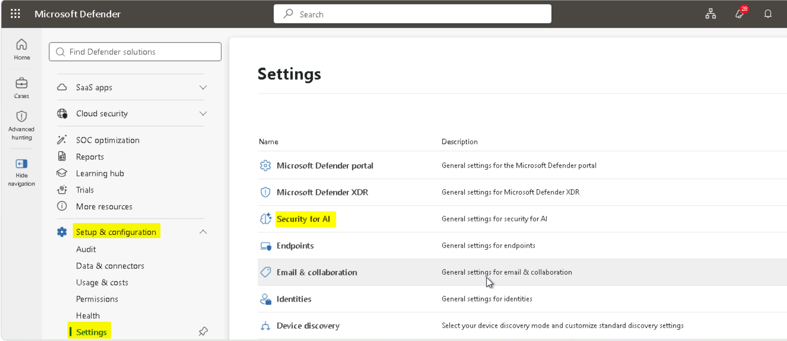

3. Confirm the **Enable** toggle is **On**. It's on by default after Agent 365 onboarding and turns on agent discovery, posture assessment and threat detection.

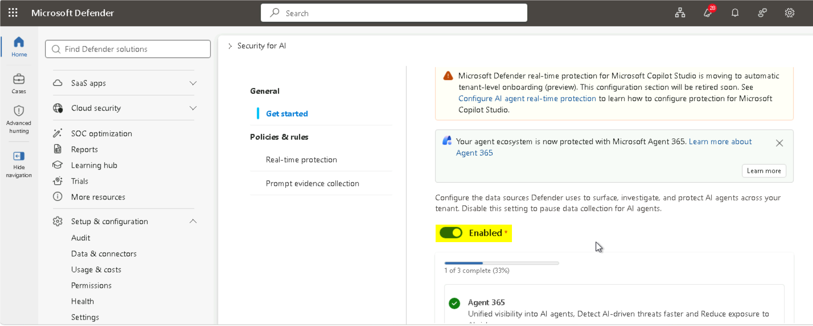

4. Review the setup checklist. **Agent 365** shows **Done** when the tenant is onboarded.

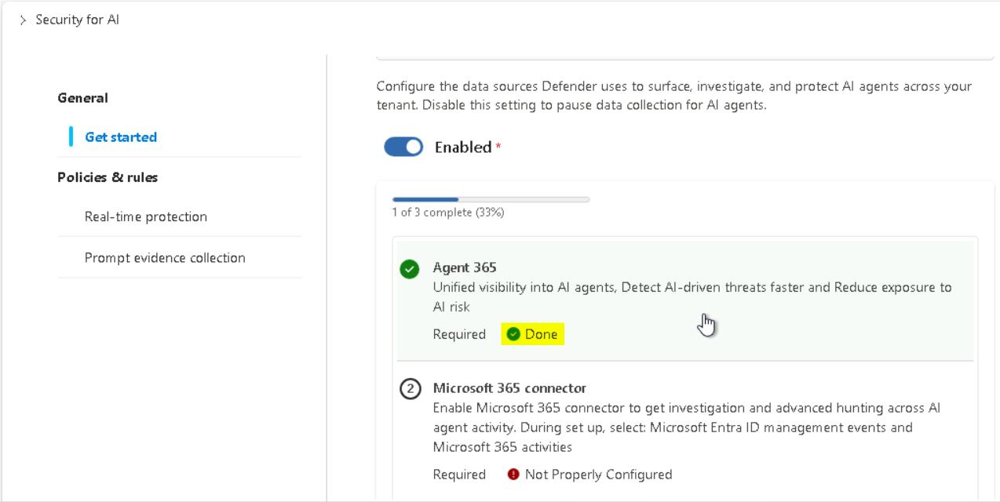

### Task 2: Connect the Microsoft 365 connector

1. On **Get started**, select the **Microsoft 365 connector** step. If it already shows **Connected**, skip to Exercise 3.

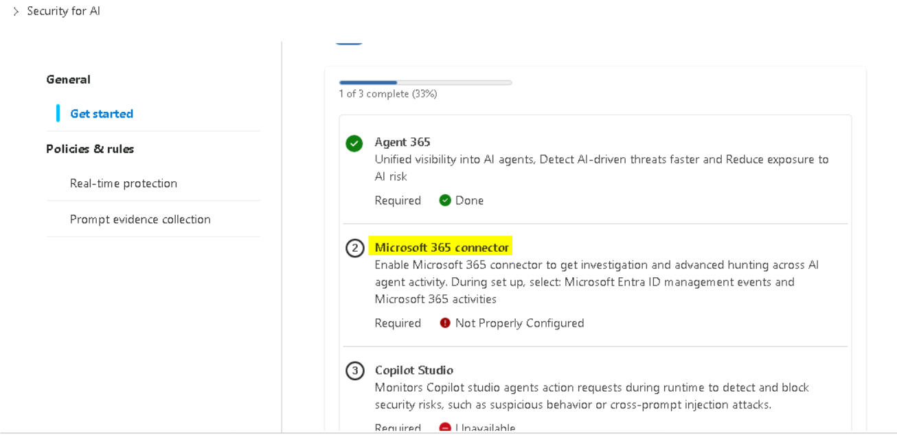

2. On **Select Microsoft 365 components**, make sure **Microsoft Entra ID Users and groups**, **Microsoft Entra ID Management events**, **Microsoft 365 activities** and **Microsoft 365 files** are selected, and click **Connect Microsoft 365**. Confirm the status changes to **Connected**.

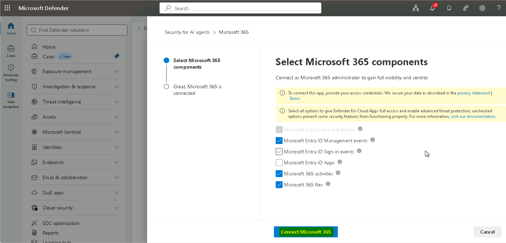

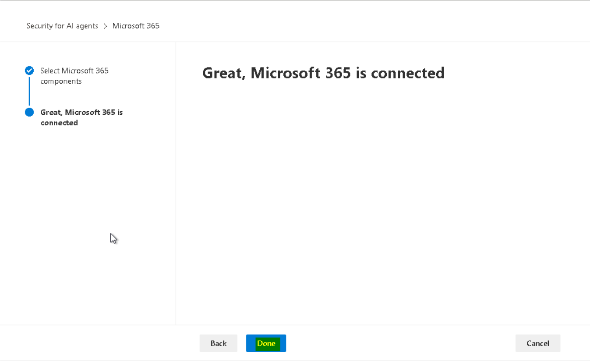

> **Note** - Without this connector, agent alerts and incidents don't appear in the Defender portal.

## Exercise 3: Review the AI Agent Inventory and Posture

### Task 1: Browse the inventory

1. Go to **Assets > AI agents** and select the **Agents** tab.

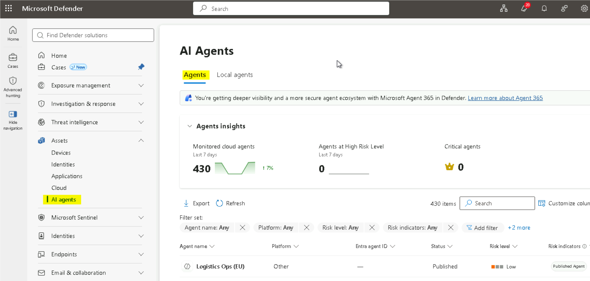

2. Review the columns: **Agent name**, **Platform**, **Publish status**, **MCP servers**, **Discovered tools**, **Risk level**, **Risk indicators**, **Recommendations** and **Active alerts**. Use **Customize columns** to add any that are hidden.

3. Filter by **Platform** and **Risk level**.

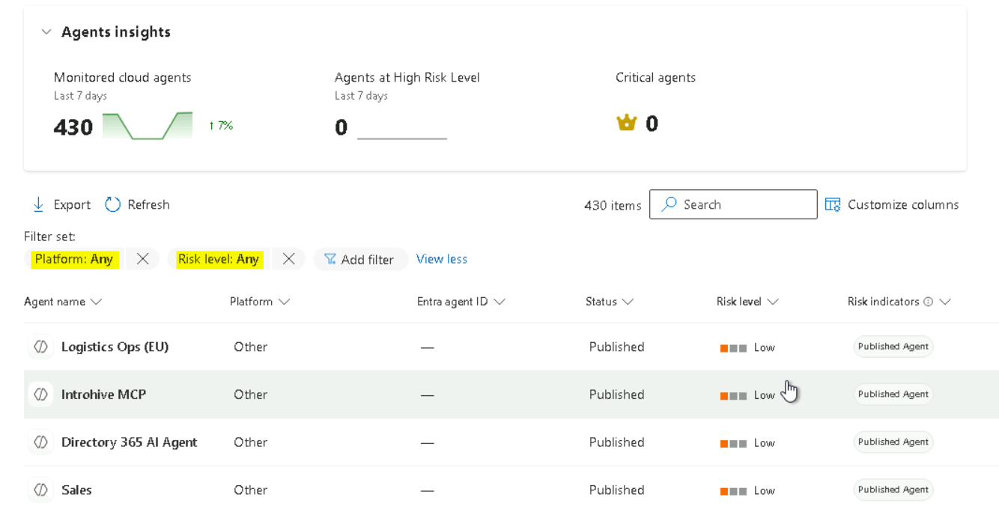

> **Note** - New agents can take some time to appear. If the inventory is empty, continue with Exercise 4.

### Task 2: Review an agent's posture

1. Select **L19 Sales Assistant** (or any listed agent) and click **Open Agent page**.

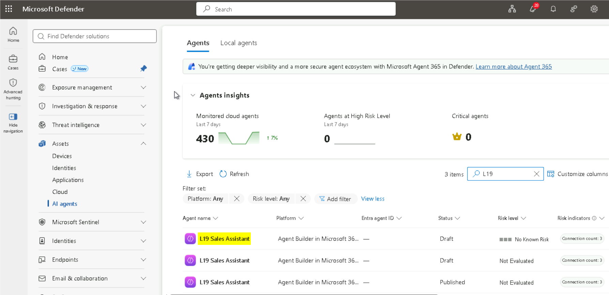

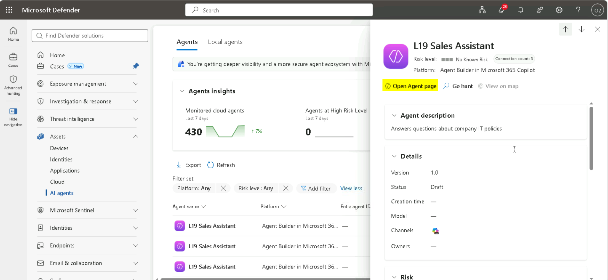

2. On **Overview**, review the risk level, identity and authentication, tools, MCP servers and attack-surface relationships.

> **Note** - The Overview is filled in from real agent activity and Microsoft 365 connector data. Because this is a demo tenant with very little activity, the Overview may be empty or show only partial data, and it can take up to 24 hours to update after you connect Microsoft 365.

3. Select **Recommendations**. If any recommendations are listed, open one and review its **Remediation steps** and **Exposed assets**.

## Exercise 4: Hunt for Agent Activity

### Task 1: Query the agent inventory

1. Go to **Investigation & response > Hunting > Advanced hunting** and run:

```kql
AgentsInfo
| summarize arg_max(Timestamp, *) by AgentId
| where LifecycleStatus != "Deleted"
```

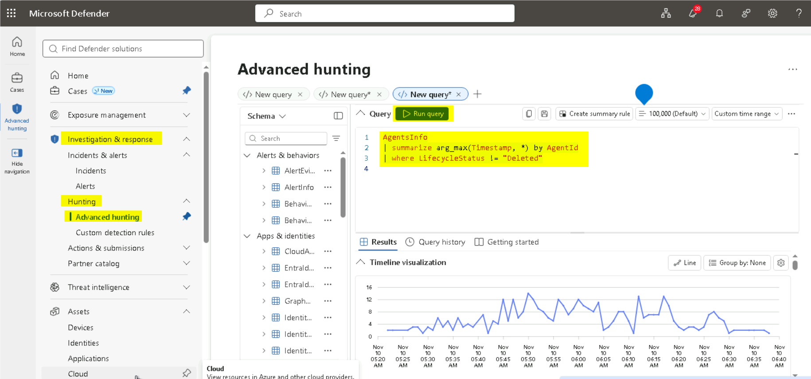

> **Note** - **AgentsInfo** stores several snapshots per agent; **arg_max** returns the latest one.

### Task 2: Query agent actions

1. Run the following query to see recent agent tool invocations and data access recorded by Agent 365 observability:

```kql
CloudAppEvents
| where Timestamp > ago(7d)
| where Application has "Agent" or ActionType has "Agent"
| project Timestamp, Application, ActionType, AccountDisplayName, ObjectName
| take 100
```

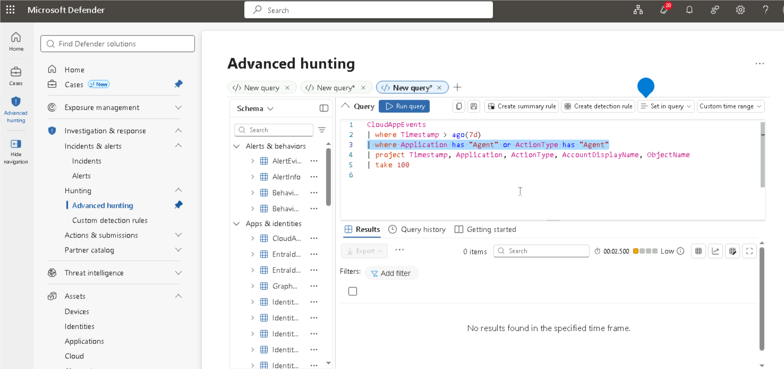

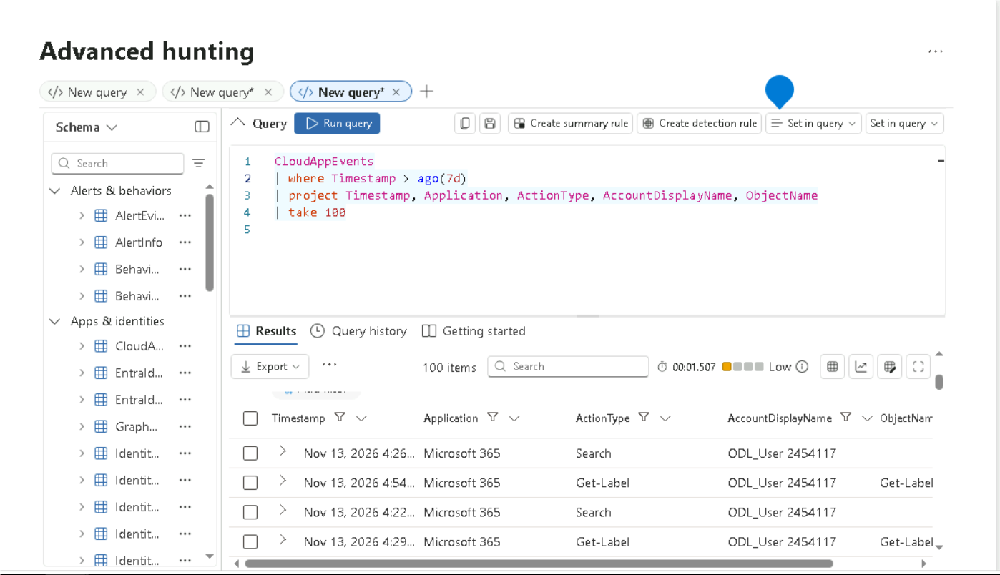

> **Note** - Field values can vary as the feature evolves. If no rows return, remove the second **where** line to browse all recent events.

## Exercise 5: Investigate and Remediate Agent Threats (Read-only)

Defender detects jailbreak attempts, indirect prompt injection (XPIA), malicious content propagation, secret and credential leakage, evasion techniques, LLM reconnaissance, and suspicious user or IP access to agents. It correlates the alerts into incidents.

> **Note** - This exercise is read-only. Agent alerts and incidents appear only when Defender detects suspicious agent activity. A demo tenant has very little activity, so the alert and incident queues will be empty. In this exercise you find where each investigation and containment control is and how it would be used. Don't block, disable or change any agent.

### Task 1: Review where agent alerts appear

1. Go to **Investigation & response > Incidents & alerts > Alerts**. Click **Filter** and review the **Service source** and **Detection source** options you would use to narrow the list to AI agent detections. You can also search by agent name.

> **Note** - No agent alerts are listed. In a production tenant, opening an agent alert shows the alert story, the agent and user entities, and the prompt evidence (a snippet of the prompt that triggered the alert).

2. Go to **Incidents** and review the same filters. Related agent alerts would be grouped into a single incident here.

### Task 2: Review how to contain a risky agent

Assume **L19 Sales Assistant** was found leaking credentials. Review the steps you would take, without applying them.

1. In the Microsoft 365 admin center, go to **Agents > All agents** and select **L19 Sales Assistant**. Find the **Block** option. Don't click it. Close the pane. Blocking the agent would stop all users from using it.

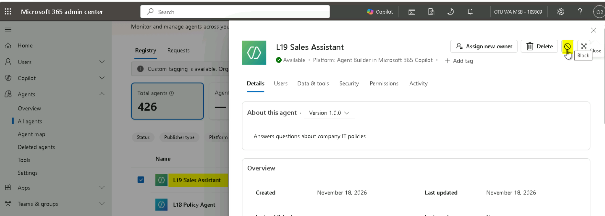

2. In the Entra admin center, go to **Entra ID > Agents** and open the agent identity, if one exists. Find the options to disable the identity or revoke its permissions. Don't apply them. Disabling the identity would stop the agent from getting tokens.

> **Note** - Conditional Access policies that block high-risk agents (Lab 17) can do this automatically when Entra marks an agent as risky.

3. In a production tenant, you would then go back to the Defender alert, set its **Classification** to **True positive** (or **Informational, expected activity** for a test), and **Resolve** it with a comment describing what you did to contain the agent.

## Summary

In this lab you turned on security for AI agents and the Microsoft 365 connector, reviewed the AI agent inventory, risk levels and recommendations, hunted for agent activity with AgentsInfo and CloudAppEvents, investigated agent alerts, and contained a risky agent by blocking it in the Microsoft 365 admin center and restricting its identity in Entra.

## Clean up resources

1. Unblock or delete **L19 Sales Assistant** as required. Leave security for AI agents turned on.
